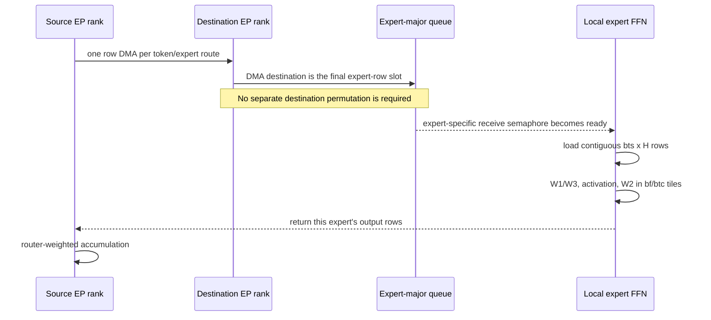
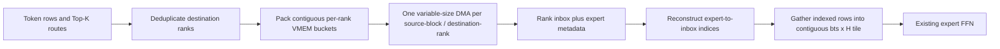

# Fused MoE v2 optimization deep dive

## Status and scope

**Last updated:** 2026-10-15

This document is a retrospective of the fused-MoE v2 optimization exploration
on branch `codex/fused-moe-rank-coalesced-a2a`. It explains the current
expert-granular implementation, the alternatives that were prototyped, the
evidence collected, and the resulting decisions. It is deliberately not a
fourth implementation plan. The detailed working plans and consultation notes
remain in:

- [Rank-coalesced A2A implementation plan](fused_moe_rank_coalesced_a2a_plan.md)
- [Rank-dispatch consultation brief](fused_moe_rank_dispatch_consultation_brief.md)
- [Workload-specialization plan](fused_moe_workload_regime_plan.md)

The most important conclusion is that reducing logical communication bytes is
not sufficient to make this TPU kernel faster. The current expert path uses DMA
placement to create the compute-ready expert layout and exposes expert-level
readiness to the compute pipeline. Rank-packed dispatch reduced logical payload
and modeled DMA starts, but replaced those properties with packing, dynamic
indexed consumption, and coarser synchronization. It was correct but slower.

The largest measured improvements came from selecting better values for the
existing `bt`, `bf`, `btc`, `bse`, and `bts` block configuration. The repository
already has a shape- and device-keyed tuning mechanism. The main actionable gap
is therefore qualified TPU v6e tuning data, not a new tuning architecture.

> [!IMPORTANT]
> None of the results in this document are checkpoint-backed serving results.
> CPU results cover reference math, planning, accounting, and selection. Device
> times are synthetic-input microbenchmarks executed on real TPU v6e hardware.
> A real-model TTFT, TPOT/ITL, and throughput gate is still required before any
> production promotion.

The GPU comparison in Section 13 is source-backed architectural analysis. No
GPU benchmark was run in this repository, so it does not provide an
apples-to-apples GPU/TPU speed comparison.

## Executive decision ledger

| Investigation | Repository status | Best evidence | Decision |
|---|---|---|---|
| Expert-granular dispatch | Existing production control | Correct, compute-ready expert queues, fine-grained overlap | Keep as default |
| Packed `rank_dispatch` | Experimental branch mode | Correct; 2.7% to 49.3% slower in completed TPU cells | Do not promote |
| `rank_direct` | Diagnostic branch mode | Removing source packing did not recover baseline latency | Keep only as a diagnostic |
| Direct-HBM `rank_broadcast` | Experimental branch mode | 4.77% and 4.15% faster at global `T=32` and `64`; slower at `T>=256` | Revisit only as a measured small-token specialization |
| `rank_dispatch_combine` | Experimental branch mode | Correct; 52.1% slower in the completed small-shape cell | Do not promote the coupled design |
| Static block tuning | Existing repository mechanism | 24.98%, 78.74%, and 61.82% synthetic-input wins on measured v6e shapes | Highest-priority path; qualify v6e entries |
| Tail-aware `btc` | Internal experimental kernel option | Helps padded layouts, but only 1.1% to 1.5% beyond the best static layout | Keep internal and off |
| Workload-regime selection | Experimental selection plumbing | CPU-tested; override table is empty; no same-complete-key collision shown | Do not attribute a speedup or populate yet |
| VMEM model | Experimental tuning support | Calibrated against observed Mosaic allocation failures | Use for pruning; compilation remains authoritative |

## 1. Terminology and evidence labels

### 1.1 MoE terms

- A **token row** is one activation vector of hidden width `H`.
- The router selects `K` experts for each token and supplies one router weight
  per selected route.
- An **expert row** is a token row assigned to one selected expert. A Top-K 8
  token normally creates eight logical expert rows.
- An **EP rank** owns a subset of experts. Several selected experts may reside
  on the same destination rank.
- **Dispatch** moves routed activations to the ranks that own the selected
  experts.
- The expert FFN applies the model's expert weights: `W1` and `W3` project from
  `H` to the intermediate dimension, the activation combines those projections,
  and `W2` projects back to `H`.
- **Return/combine** moves expert outputs back and applies the router-weighted
  sum for each original token.

`BENCH_TOKENS` is the global number of token rows in one MoE invocation. It is
not sequence length, a serving-phase label, or a number of repeated decode
iterations. Decode can still have many rows when many requests are batched.

### 1.2 Evidence labels used here

| Label | What it establishes | What it does not establish |
|---|---|---|
| `MODEL` | Algebraic bytes, rows, starts, or tile counts | Physical ICI traffic or latency |
| `CPU-ORACLE` | Reference math, routing plans, config lookup, selector gates, VMEM accounting | TPU compilation or performance |
| `TPU-SYNTHETIC-CLEAN` | Device time on real TPU from a clean commit with synthetic inputs | Checkpoint-backed serving performance |
| `TPU-SYNTHETIC-DIRTY` | Device time on real TPU from the experimental worktree | Production provenance or serving performance |
| `SERVING` | Checkpoint-backed end-to-end server result | No such result has been collected for this exploration |

The JSONL fields named `modeled_*` are algorithmic counts, not hardware
counters. Likewise, `logical_*_bytes` are derived payload quantities, not
observed ICI bytes. They are useful for explaining an algorithm and bounding an
opportunity, but they cannot prove that communication is exposed on the critical
path.

## 2. Existing fused-MoE v2 implementation

### 2.1 High-level dataflow

The production control is `a2a_mode="expert"` in
[`kernel.py`](../../python/sgl_jax/srt/kernels/fused_moe/v2/kernel.py). The
router has already produced expert IDs and router weights when the fused kernel
starts.



The source activation row exists only once in the input buffer. When the token
selects several experts, the same row is read and transmitted once per route.
"Duplicate payload" therefore means repeated communication of the same source
row; it does not mean duplicate source storage.

### 2.2 DMA placement performs the route permutation

Suppose the routes are:

```text
t0 -> e1, e3
t1 -> e3
t2 -> e1
```

The destination needs expert-major queues:

```text
e1: [t0, t2]
e3: [t0, t1]
```

Prefix-calculated `expert_starts` plus per-expert offsets determine the remote
destination row for every route. Each DMA still copies one contiguous row, but
the collection of destination addresses deposits the rows directly into the
two queues above. Data movement and placement are the same operation. There is
no intermediate rank-major inbox that must later be permuted.

The destination address must be unique while a transfer is outstanding. The
kernel, rather than the Python inference scheduler, calculates the offsets,
uses rotating scratch banks, and waits for outstanding transfers before a bank
is reused. Pallas DMA send and receive semaphores provide the completion
protocol. A semaphore is a TPU kernel synchronization primitive, not host-side
threading state.

### 2.3 Why the existing path overlaps communication and compute

Receive readiness is tracked per expert. An expert waits immediately before it
loads its own input rows. Once that expert is ready, its FFN can run even if a
later expert is still receiving rows. Its output gather can begin before the
later expert executes. The next outer token block can also begin dispatch while
the current block is being computed, subject to scratch-bank reuse.

This overlap is a property of both data layout and synchronization granularity:

```text
expert 0 rows arrive -> expert 0 FFN -> expert 0 return
         expert 1 rows arrive -> expert 1 FFN -> expert 1 return
                  next block dispatch may already be in flight
```

The existing path is not attractive because it has few modeled DMA starts; it
does not. Its advantage is that each row transfer produces the final contiguous
expert layout and an expert-specific readiness event.

### 2.4 Expert FFN tiling

[`FusedMoEBlockConfig`](../../python/sgl_jax/srt/kernels/fused_moe/v2/kernel.py)
contains five fields:

| Field | Meaning |
|---|---|
| `bt` | Outer local-token block used by routing, scatter/gather, and the pipeline |
| `bf` | Slice of the expert intermediate dimension loaded and computed together |
| `btc` | Fixed number of expert rows in an MXU compute group |
| `bse` | Shared-expert block size |
| `bts` | Maximum routed-expert rows resident for one expert FFN tile |

`bts` controls the resident row window; `btc` controls the fixed row dimension
of each dot. A `bts=32, btc=8` tile is four fixed compute groups, not four
separate expert-weight loads. `bf` controls how much of `W1`, `W3`, and `W2` is
streamed at a time. Larger values can reduce loop/control and repeated movement,
but they consume more VMEM and can waste work when the expert has few rows.

The kernel is model-aware through arguments such as hidden size, intermediate
size, expert count, Top-K, activation, quantization, shared-expert settings, and
optional SwiGLU limits. It is not hard-coded to one model's FFN.

### 2.5 Existing config selection is already structured

[`tuned_block_configs.py`](../../python/sgl_jax/srt/kernels/fused_moe/v2/tuned_block_configs.py)
already looks up a tuple using device and complete model/runtime shape keys,
then applies a generic fallback and effective-shape constraints. At the time of
this audit, the table has TPU v7 entries but no TPU v6e table. That absence is a
data/qualification gap, not evidence that a new configuration system is needed.

The measured-config lifecycle also already exists in
[`gmm_v2.py`](../../python/sgl_jax/srt/kernels/gmm/megablox_gmm_kernel/gmm_v2.py)
and other tuned kernels. Fused MoE should reuse the lifecycle—generate legal
candidates, benchmark a complete key, retain evidence, and promote a winner—
without forcing the fused kernel to call GMM v2 or reuse GMM's tile schema.

## 3. Communication opportunity model

For BF16 activations:

```text
row_bytes = H * 2
expert_dispatch_bytes = T * K * row_bytes
rank_deduplicated_bytes = T * mean_unique_destination_ranks * row_bytes
saved_bytes = T * (K - mean_unique_destination_ranks) * row_bytes
```

For ICI opportunity, the calculation must include only remote expert routes and
remote unique ranks. Local copies do not use ICI.

At `T=128`, Top-K 8, the global logical one-way dispatch saving is:

| Model | H | Mean ranks/token | Logical bytes saved per MoE layer |
|---|---:|---:|---:|
| DeepSeek-V3 | 7,168 | 1 | 12.25 MiB |
| DeepSeek-V3 | 7,168 | 4 | 7.00 MiB |
| MiMo-V2-Flash | 4,096 | 1 | 7.00 MiB |
| MiMo-V2-Flash | 4,096 | 4 | 4.00 MiB |

These are global logical quantities, not per-chip observed traffic. A uniform
EP=4 occupancy reference touches about 3.614 ranks per Top-K 8 token. After
excluding the source rank, the modeled remote saving at `T=128` is about
5.76 MiB for DeepSeek-V3 and 3.29 MiB for MiMo-V2-Flash across the slice.

A bandwidth-only lower bound is:

```text
payload_time_ms = remote_bytes_on_critical_chip / effective_bytes_per_second * 1e3
transport_time ~= descriptor_startup + payload_time + contention - overlap
```

At hypothetical 100 to 400 GB/s effective bandwidth, the uniform EP=4 modeled
savings correspond to only 0.0151 to 0.00377 ms per DeepSeek-V3 MoE layer and
0.00862 to 0.00216 ms per MiMo-V2-Flash MoE layer. Multiplying by the number of
MoE layers produces an optimistic model-wide ceiling only if every transfer is
exposed. If expert-weight streaming or MXU work hides communication, the actual
latency saving can be zero.

This is why a multi-MiB logical saving is worth measuring but does not by itself
justify changing the layout.

## 4. Rank-packed dispatch

### 4.1 Motivation and algorithm

`rank_dispatch` tries to send a token row once per unique destination rank,
rather than once per selected expert:



The destination rank is implicit in the expert ID, so a separate rank field is
not required for every route. Metadata still has to describe which inbox rows
belong to which local experts and, for destination combine, their router
weights.

This resembles the contiguous data/offset/size contract of JAX
[`ragged_all_to_all`](https://docs.jax.dev/en/latest/_autosummary/jax.lax.ragged_all_to_all.html)
and the high-throughput dispatch/combine goal of
[DeepEP](https://github.com/deepseek-ai/DeepEP). Those are references for the
communication abstraction, not proof that the GPU design maps efficiently to a
Pallas TPU kernel. DeepEP also has distinct low-latency and high-throughput
paths, reinforcing the need to measure workload regimes rather than assume one
protocol fits every token count.

### 4.2 Expected reduction

For controlled one-rank routing at `T=128`, `K=8`, and EP=4:

| Mode | Modeled activation rows | Modeled dispatch starts | Local row copies before expert FFN |
|---|---:|---:|---:|
| Existing `expert` | 1,024 | 1,024 | 0 separate permutation copies |
| Packed `rank_dispatch` | 128 | 16 | 128 source packing copies plus indexed destination loads |

The counts are algorithmic. No TPU hardware counter was captured to prove a
physical start count or ICI byte count.

### 4.3 TPU results

`TPU-SYNTHETIC-DIRTY`, single v6e-4, BF16, `E=32`, `K=8`, `I=1024`, controlled
one-rank routing:

| Global T | H | Existing `expert` | Packed `rank_dispatch` | Result |
|---:|---:|---:|---:|---:|
| 128 | 1,024 | 0.071 ms | 0.106 ms | 49.3% slower |
| 128 | 8,192 | 0.328 ms | 0.337 ms | 2.7% slower |
| 512 | 8,192 | 1.258 ms | 1.334 ms | 6.0% slower |

The optimized cells passed numerical comparison. This is a performance loss,
not a correctness failure.

### 4.4 Why it did not win

The experiment changed more than payload volume:

1. The source scans routes and constructs rank-major buckets.
2. The destination receives a rank-major inbox rather than compute-ready
   expert-major queues.
3. Scalar/data-dependent metadata reconstructs the expert subsets.
4. Each expert uses dynamic indices to load its rows into a contiguous compute
   tile.
5. Readiness becomes tied to the rank inbox instead of each expert's final
   queue, weakening the existing communication/compute pipeline.

The `T=512` cell is especially informative: it moved 87.5% fewer logical
activation rows under one-rank routing and was still 6.0% slower. The saved
payload was either not the exposed bottleneck or was outweighed by the new
layout and control cost.

### 4.5 Decision and reopen condition

Do not promote packed `rank_dispatch`. Reopen it only if both conditions hold:

- a device trace or isolated transport experiment shows material exposed
  remote-activation time for the target shape; and
- a destination consumer preserves expert-level readiness and produces regular
  tiled inputs without a dynamic row-by-row gather on the critical path.

Merely replacing the transport with `ragged_all_to_all` does not satisfy the
second condition.

## 5. Rank-direct diagnostic

`rank_direct` was introduced to isolate source packing from destination
consumption. It keeps exact token/rank deduplication but does not build a
contiguous ragged bucket. It stages the original dense source block and issues
one row DMA for each unique token/destination-rank pair into fixed inbox slots.

At the same one-rank `T=128` point:

```text
rank_direct:   128 modeled rows, 128 modeled starts
rank_dispatch: 128 modeled rows,  16 modeled starts
```

Correctness passed, and `rank_direct` matched packed-dispatch latency at
`T=128`. There is no separately retained standalone timing table for this
diagnostic, so the conclusion should stay qualitative: eliminating ragged
source packing did not recover the expert baseline. The destination-side
reconstruction/indexed load and lost readiness were therefore more important
than source packing alone.

Decision: keep `rank_direct` as a diagnostic, not a production candidate.

## 6. Direct-HBM rank broadcast

### 6.1 Motivation and algorithm

`rank_broadcast` explores the opposite tradeoff. Instead of packing only the
selected rows, it sends the unchanged dense `bt x H` block once to each
participating destination rank. Metadata tells the destination which rows and
experts are relevant.

```text
packed rank dispatch: exact rows, source packing, destination indexed consume
rank broadcast:       extra rows, no source packing, few regular dense DMAs
```

The later direct-HBM version sends from the original HBM block and removes an
unused approximately 5 MiB source VMEM staging buffer and its semaphore. It is
not "packing in HBM"; the source block already exists there in dense form.

For one-rank `T=128`, the model predicts 512 broadcast rows and 16 starts,
between expert mode's 1,024 rows/1,024 starts and packed mode's 128 rows/16
starts.

### 6.2 TPU results and crossover

`TPU-SYNTHETIC-DIRTY`, v6e-4, random routing, BF16, `H=8192`, `I=1024`,
`E=32`, `K=8`, EP=4:

| Global T | Expert p50 | Broadcast p50 | Change |
|---:|---:|---:|---:|
| 32 | 0.303173 ms | 0.288712 ms | 4.77% faster |
| 64 | 0.313143 ms | 0.300163 ms | 4.15% faster |
| 128 | 0.448801 ms | 0.445009 ms | 0.84% faster |
| 256 | 0.949149 ms | 0.953810 ms | 0.49% slower |
| 512 | 2.006105 ms | 2.037165 ms | 1.55% slower |

The `T=32` and `T=64` figures summarize three alternating expert/broadcast
runs. The `T=128/256/512` cells are the initial crossover sweep. Numerical
checks passed at `T=128` and `512`. A controlled four-rank `T=512` cell was
also slower: 1.288 versus 1.269 ms.

The small-token A/B used identical explicit tiles to isolate transport, but
those tiles did not match the production-resolved small-token config. This is
not yet a production-relative decode result.

### 6.3 Why it can win and then lose

At small `T`, the regular dense transfer avoids both per-route start overhead
and ragged source packing. The extra rows are few enough that this regularity
wins. As `T` grows, sending rows that no local expert uses becomes a bandwidth
and inbox cost. The crossover around `T=128` to `256` is exactly the expected
tradeoff between startup/control and payload.

### 6.4 Decision and reopen condition

Keep rank broadcast experimental and off. It is the only communication
alternative with a measured positive region, but that region is narrow and
synthetic. Reopen it as a small-token serving specialization only after:

1. using the exact production-resolved block config;
2. measuring real route fan-out and token buckets from a checkpoint-backed
   server;
3. showing TPOT/ITL benefit without throughput or TTFT regression; and
4. defining a selector with a safe fallback to `expert`.

## 7. Destination-side combine

### 7.1 What it changes

The existing return path sends one BF16 output row per expert route and applies
router weights on the source. `rank_dispatch_combine` instead applies router
weights on the destination, accumulates all local expert outputs for a source
token in FP32, returns one partial per source-token/destination-rank pair, and
sums the rank partials on the source.


The router weight therefore travels in dispatch metadata. The FP32 partial is a
numerical choice, not free compression.

### 7.2 Byte breakeven

```text
expert_return_bytes = T * K * H * 2
fp32_rank_return_bytes = T * mean_unique_destination_ranks * H * 4
saved = T * H * (2*K - 4*mean_unique_destination_ranks)
```

For Top-K 8, FP32 destination combine reduces return bytes only when the mean
rank fan-out is below four. It is byte-neutral at four and sends more bytes
above four. Under one-rank routing it saves 75% of return bytes, while BF16
dispatch dedup saves 87.5%.

### 7.3 TPU result

At `T=128`, `H=1024`, one-rank routing:

| Mode | Device time | Correctness |
|---|---:|---|
| Existing `expert` | 0.071 ms | control |
| `rank_dispatch_combine` | 0.108 ms | max abs 0.0001, relative 0.003623 |

The combined mode was correct but 52.1% slower. It inherits the packed-dispatch
costs and adds dynamically addressed FP32 read/modify/write accumulation. The
experiment does not isolate combine from packed dispatch, so it cannot prove
that destination combine alone is slow.

### 7.4 Decision and reopen condition

Do not promote the coupled `rank_dispatch_combine` design. If a future trace
shows that expert-output return and source combine are exposed, test an
independent `expert_dispatch_combine` variant that preserves the existing
expert-major dispatch and readiness. Otherwise there is no evidence that the
return path is the right bottleneck to optimize.

## 8. Static block configuration tuning

### 8.1 Capability audit

This is the strongest result and also the clearest example of an existing
repository capability. The v2 kernel, lookup table, benchmark sweep, and shape
keys already support measured static configurations. The branch added evidence,
selection checks, and tuning support; it did not invent model- or device-keyed
kernel configuration.

The production table currently lacks `TPU v6e` entries. A v6e candidate should
be added to the existing table only after qualification, rather than by adding
a parallel model-name table or a new kernel.

### 8.2 Results

| Evidence | Hardware and shape | Production fallback -> candidate | Result |
|---|---|---|---:|
| `TPU-SYNTHETIC-CLEAN` | v6e-4, `T=128`, BF16 | `(32,512,32,256,32)` -> `(32,256,64,256,64)` | p50 0.448601 -> 0.336544 ms, 24.98% faster |
| `TPU-SYNTHETIC-CLEAN` | v6e-4, `T=4096`, BF16 | `(32,512,32,256,32)` -> `(128,256,160,256,160)` | p50 18.734 -> 3.982 ms, 78.74% faster |
| `TPU-SYNTHETIC-DIRTY` | MiMo-shaped v6e-16, `T=2048`, FP8 blockwise, EP=16 | `(32,512,32,256,32)` -> `(128,1024,80,256,80)` | across-run mean p50 1.379727 -> 0.526838 ms, 61.82% faster |
| `TPU-SYNTHETIC-DIRTY` | Same MiMo shape, hot-expert routing | same | 6.218 -> 3.117 ms, 49.9% faster |

The MiMo-shaped test used `E=256`, `H=4096`, `I=2048`, Top-K 8, block-wise
FP8 expert weights, BF16 outputs, activation quantization, and EP=16. It matched
the model architecture but did not load a model checkpoint.

### 8.3 Why larger blocks helped

The wins came from compute layout and loop amortization, not a communication
rewrite:

- larger `bt` reduced outer pipeline rounds and exposed more rows together;
- larger `bts` kept more expert rows resident while weight slices were applied;
- larger `btc` reduced fixed compute-group count when enough rows existed; and
- larger `bf` reduced intermediate-dimension slice iterations when VMEM allowed.

Power-of-two sizes are not a requirement. The existing table contains aligned
non-power-of-two values such as 40, 48, 56, 72, 80, 96, 112, and 160. For the
MiMo-shaped EP=16 experiment, the expected average routed rows per expert were
64, and 80 was a legal 25%-headroom candidate. Measured `64/64` was about
0.725 ms while `80/80` was about 0.529 ms in that sweep. Measurement, divisibility,
alignment, and VMEM legality—not aesthetic powers of two—choose the winner.

### 8.4 Decision

Prioritize qualified v6e table entries. Run the exact static candidate through
checkpoint-backed serving before promotion. Do not credit these gains to
phase-aware selection: the tuple itself produced the speedup.

## 9. Tail-aware `btc`

For `r` rows assigned to an expert in one outer block:

```text
static groups = ceil(r / bts) * (bts / btc)
tail-aware groups = ceil(r / btc)
```

Tail-awareness preserves the fixed `btc` dot shape and skips only wholly empty
groups in the final partially occupied `bts` tile. It does not remove padding
inside the final non-empty compute group. It is an internal kernel option,
defaults to false, and is not exposed as a public server flag.

### 9.1 Results

| Hardware | Matched layout | Static | Tail-aware | Change |
|---|---|---:|---:|---:|
| v6e-4 | `btc=8, bts=32` | 0.482852 ms | 0.465152 ms | 3.67% faster |
| v6e-4 | `btc=8, bts=64` | 0.605399 ms | 0.382659 ms | 36.79% faster |
| v6e-16 random | `(128,1024,32,256,128)` | 0.705 ms | 0.519 ms | 26.4% faster |
| v6e-16 hot expert | same | 3.240 ms | 3.083 ms | 4.8% faster |

Those comparisons prove that the mechanism can remove empty work. They do not
prove that it is the best layout. The best static v6e-4 decode point was about
0.337 ms with `btc=bts=64`, which has no empty groups to skip. On v6e-16, the
tail-aware result beat the best static layout by only 1.5% for random routing
and 1.1% for hot-expert routing.

Decision: keep it internal and off. Reopen only when the globally best static
production tuple has `btc < bts` and tail-awareness beats that best tuple—not
merely a deliberately padded matched layout—in both kernel and serving metrics.

## 10. Workload-regime selection

The experimental branch maps plain decode to a latency regime, extend/prefill
to a throughput regime, and ambiguous modes to `auto`. `auto` preserves the
pre-existing lookup. The optional regime table is empty.

This selection mechanism is not an independent kernel optimization. It can only
choose a static tuple or transport mode whose benefit was established
separately. The existing key already includes token count and model/runtime
shape, so it often distinguishes decode-like and prefill-like workloads without
an explicit phase label.

A regime override is justified only by a genuine **same-complete-key phase
collision**: the same device, full model/runtime key, and token bucket select
different winners in decode and extend because route distribution or serving
objective changes. Comparing `T=128` decode-like and `T=4096` prefill-like
microbenchmarks does not show that collision because the token-count key already
differs.

Decision: retain `auto`, leave the override table empty, and attribute the
measured gains to static block tuning. Populate a regime entry only after real
workload evidence shows a same-complete-key collision.

## 11. VMEM feasibility modeling

Candidate generation needs a cheap way to reject impossible shapes before
paying TPU compilation cost. [`vmem_model.py`](../../python/sgl_jax/srt/kernels/fused_moe/v2/vmem_model.py)
shares logical scratch geometry with the benchmark and applies a calibrated
1.20x allowance to relevant expert working-set components.

Three quantities must not be conflated:

1. physical VMEM advertised by the TPU generation;
2. the kernel/compiler budget requested by this implementation; and
3. logical scratch bytes estimated from visible arrays.

The initial logical-under-64-MiB rule admitted five candidates for which Mosaic
reported scoped allocations of 65.63, 68.44, 72.82, 81.62, and 94.60 MiB. The
calibrated filter rejects those observed failures while retaining the observed
successful candidates.

The 1.20 factor is empirical, not a hardware law. Compiler temporaries,
alignment, register spills, JAX/libtpu changes, quantization, and A2A mode can
change the real allocation. The estimator is useful for pruning and explaining
candidates; successful lowering and execution remain authoritative.

## 12. What the experiments collectively teach us

### 12.1 Bytes, starts, layout, and overlap are separate axes

```text
whole-kernel time
  = exposed transport
  + exposed layout/control
  + exposed weight movement and FFN compute
  - useful overlap
```

These terms do not add cleanly when they overlap. A transfer can have a long
start/end interval but contribute little exposed time if it runs behind weight
streaming. Conversely, reducing bytes can lose if it serializes a previously
pipelined layout conversion.

The packed-dispatch result is the central example:

```text
87.5% fewer modeled activation rows
far fewer modeled starts
but 2.7% to 49.3% worse whole-kernel time
```

The broadcast crossover is the complementary example: regular dense transfers
can beat exact sparse transfer at small token counts, then lose when redundant
payload dominates.

### 12.2 TPU compute prefers regular, contiguous tiles

The existing expert path uses remote placement to create a contiguous expert
queue. Packed rank dispatch produces an efficient rank-level message but a
less convenient compute layout. A rank inbox is useful only if the consumer can
turn it into expert work without scalar gathers, coarse waits, or another full
fan-out copy.

This is the connection to [MegaBlocks](https://arxiv.org/abs/2211.15841): the
general lesson is to retain regular block computation while avoiding padding
or movement, not to assume that arbitrary ragged access will be cheap. The
repository's GMM kernel is useful prior art for tuning and regular grouping, but
it is not a drop-in replacement for this fused communication/FFN pipeline.

### 12.3 The proven opportunity is presently compute-layout tuning

Communication experiments found one narrow positive window and several
correct-but-slower paths. Static tiling found repeatable 25% to 79% synthetic
kernel wins without changing the communication protocol. That difference in
evidence should control prioritization.

## 13. GPU comparison: why rank-deduplicated EP can work there

### 13.1 The short answer

The GPU and TPU results are not contradictory because the end-to-end algorithms
are different.

Current DeepEP does not simply hand a deduplicated, unsorted rank inbox to the
expert GEMM. Its rank accounting counts a token once per destination scale-up
rank even when several selected experts live there, but its recommended
`do_expand=True` path then expands and aligns the received tokens into
expert-grouped segments. The grouped GEMM consumes that regular layout.

Our TPU `rank_dispatch` prototype also deduplicated the transport, but its
consumer retained the flat rank inbox. Before each expert ran, a scalar-controlled
loop followed dynamic indices and copied rows one at a time into the regular
`bts x H` tile. It also waited for the expected rank-inbox payload rather than
preserving the baseline's expert-specific receive readiness. The measurements
prove that this complete path was slower; they do not yet isolate which of
these added operations or synchronization changes caused how much of the loss.

```mermaid
flowchart TB
    subgraph GPU[DeepEP-style GPU path]
        G1[One token per destination rank] --> G2[NVLink / RDMA transport]
        G2 --> G3[Parallel dispatch epilogue expands and aligns by expert]
        G3 --> G4[Contiguous expert segments plus prefix sums]
        G4 --> G5[Grouped GEMM]
        G5 --> G6[Weighted combine]
    end

    subgraph TPU[Current TPU rank_dispatch prototype]
        T1[One token per destination rank] --> T2[ICI remote DMA]
        T2 --> T3[Flat rank inbox]
        T3 --> T4[Whole-inbox wait and expert-index reconstruction]
        T4 --> T5[Per-expert dynamic row loads into bts x H]
        T5 --> T6[Existing tiled expert FFN]
    end
```



The transferable lesson is therefore not "rank dedup works on GPU but cannot
work on TPU." It is:

> Rank-deduplicated transport is a viable end-to-end optimization only when the
> destination layout conversion and readiness protocol remain cheaper than the
> communication they remove. That balance must be measured, not inferred from
> wire bytes alone.

### 13.2 What current DeepEP actually guarantees

The current [DeepEP README](https://github.com/deepseek-ai/DeepEP/blob/main/README.md),
inspected at `main` on 2026-10-15, describes a unified `EPBuffer` interface for
high-throughput and low-latency dispatch/combine. Its current backend uses
lightweight NCCL Gin device-side communication over NVLink and RDMA; the legacy
V1 NVSHMEM backend has been removed.

The source contract in
[`deep_ep/buffers/elastic.py`](https://github.com/deepseek-ai/DeepEP/blob/main/deep_ep/buffers/elastic.py)
separates transport counts from compute layout:

1. `psum_num_recv_tokens_per_scaleup_rank` counts deduplicated received tokens.
   A token is counted once per rank even if several of its Top-K experts are on
   that rank.
2. With `do_expand=True`, dispatch produces expert-grouped segments padded to
   `expert_alignment`.
3. `psum_num_recv_tokens_per_expert` identifies the expert segment boundaries
   and valid row counts.
4. The README's inference example selects `do_expand=True`, zero-fills alignment
   gaps, and chooses an alignment accepted by the grouped GEMM.
5. For decoding, `do_cpu_sync=False` avoids obtaining exact expert counts on
   the CPU. Output is allocated to capacity and the GEMM consumes device-side
   prefix sums. Training and prefill commonly use CPU-known exact counts.

This is a crucial correction to the phrase "GPU rank dispatch." Network payload
can be rank-deduplicated while the local representation is deliberately
re-expanded per expert. The local fan-out has not disappeared; it has been
placed in a parallel communication epilogue that produces the layout required
by compute.

DeepEP also applies the expanded router weights to expert outputs before its
combine operation. That resembles destination-side weighting, but it is not
identical to this branch's dynamically addressed FP32 rank-partial prototype.

### 13.3 The GPU compute contract is already expert-contiguous

NVIDIA's
[CUTLASS contiguous-offset grouped GEMM](https://docs.nvidia.com/cutlass/latest/media/docs/operators/tutorials/005_grouped_gemm_contiguous_offset.html)
represents the token operand as one `TotalM x K` tensor containing contiguous
segments for several GEMM problems:

```text
expert 0: M0 x K
expert 1: M1 x K
expert 2: M2 x K
...
```

An offsets vector marks each expert's segment. `N` and `K` remain regular while
only each expert's `M` varies. This is fundamentally different from asking the
GEMM to follow an arbitrary index list into a rank-major inbox.

GPU libraries therefore solve two problems separately:

```text
communication layout: one token per destination rank
compute layout:       aligned contiguous rows per expert
```

The dispatch epilogue bridges those layouts before grouped GEMM. A non-expanded
DeepEP receive buffer can be useful for transport or another custom consumer,
but it is not automatically a compute-ready input for a contiguous grouped
GEMM.

### 13.4 Why the local expansion is more viable on GPU

Several GPU properties help, but none makes arbitrary layout conversion free:

- DeepEP dispatch/combine are GPU kernels that consume a configurable number of
  SMs. The library estimates SM and queue-pair counts from topology and traffic,
  and callers may override the SM allocation.
- Many SMs and warps can process received rows, metadata, alignment padding, and
  expert segments in parallel. The expansion is not embedded as one dynamic
  row-load loop inside a sequential expert loop.
- Communication uses a separate CUDA stream and returns an `EventOverlap`.
  Dispatch can be launched before independent work and waited only where its
  output is consumed. This permits overlap; it does not guarantee it.
- Hopper's Tensor Memory Accelerator can issue regular asynchronous 1D-to-5D
  copies between global and shared memory, while other warps continue. TMA is a
  useful building block for regular tiled stages, but it is neither DeepEP's
  cross-GPU transport nor a general arbitrary indexed-gather engine.
- CUTLASS and DeepGEMM provide mature grouped-GEMM consumers for the expanded
  layout, so the dispatch layout and compute kernel are designed together.

This does not mean communication uses no compute resources. The current DeepEP
README explicitly says EP dispatch and combine require GPU SMs. The useful
property is controllable parallelism and scheduling, not a free, independent
communication processor.

### 13.5 The TPU execution model and this prototype

Google's [TPU v6e architecture](https://docs.cloud.google.com/tpu/docs/v6e)
specifies one TensorCore per chip, with two MXUs, one vector unit, and one scalar
unit. Pallas presents a kernel as a mostly sequential program whose DMA, vector,
and MXU operations may overlap when scheduling, buffers, and waits permit it.

The [Pallas distributed programming model](https://docs.jax.dev/en/latest/pallas/tpu/distributed.html)
uses push-only remote DMA. A source names a remote destination, calls
non-blocking `.start()`, and uses DMA send and receive semaphores for completion.
TPU therefore can overlap communication and computation. The difference is not
"GPU is asynchronous, TPU is synchronous."

The relevant differences in the current implementation are:

| Property | DeepEP-style GPU pipeline | Current TPU rank prototype |
|---|---|---|
| Wire payload | Deduplicated per destination rank | Deduplicated per destination rank |
| Post-receive layout | Parallel expert expansion with alignment | Flat rank inbox plus per-expert index queues |
| GEMM input | Contiguous expert segments and offsets | Rows dynamically copied into `bts x H` immediately before each expert |
| Readiness | CUDA event/stream contract around dispatch epilogue | Wait for expected rank-inbox payload |
| Local parallelism | Configurable communication SMs and many warps | One v6e TensorCore program; scalar/vector work surrounds the expert loop |
| On-chip scheduling | Warp- and stream-level specialization available | Compiler-scheduled DMA/VPU/MXU pipeline with explicit semaphores |
| Phase behavior | CPU-known exact counts commonly for prefill; capacity plus device counts for decode | Static shape lookup; experimental regime override remains unproven |

The TPU baseline is already very strong at the layout step: each remote DMA
writes the row directly into its final expert-major queue. The transport itself
performs the permutation, and a per-expert semaphore exposes readiness. Packed
rank dispatch removed duplicate network rows but replaced that zero-extra-pass
placement with:

1. source rank scanning and VMEM packing;
2. a rank-major inbox;
3. destination route reconstruction;
4. a whole-inbox receive wait; and
5. a non-unrolled loop of dynamic VMEM row copies for every expert tile.

That is not the same end-to-end contract as DeepEP's expanded layout followed by
grouped GEMM.

### 13.6 Why raw bandwidth is not a sufficient explanation

Peak specifications are useful only to reject an overly simple explanation:

| Peak reference | H100 SXM | TPU v6e |
|---|---:|---:|
| Local HBM bandwidth | 3.35 TB/s | 1.638 TB/s |
| Scale-up interconnect, bidirectional aggregate | 900 GB/s NVLink | 800 GB/s ICI |

The H100 product numbers come from NVIDIA's
[H100 specifications](https://www.nvidia.com/en-us/data-center/h100/), and the
v6e numbers come from Google's
[v6e documentation](https://docs.cloud.google.com/tpu/docs/v6e).
They are not directly comparable application bandwidths: topology, direction,
message size, contention, and software stack differ. They do show that the two
scale-up links are in the same broad peak range. "The GPU network is simply much
faster" cannot explain our result.

The stronger explanations are implementation-specific and remain hypotheses
until traced:

- the existing TPU route-wise DMA may already be hidden behind weight movement
  or MXU work;
- the whole-rank wait may expose latency that expert-specific waits previously
  hid;
- dynamic route reconstruction and row loads may add exposed scalar/VPU and
  VMEM work;
- extra rank buffers may constrain VMEM layout or otherwise affect scheduling;
  and
- the GPU pipeline may amortize expansion through parallel SM execution and a
  compute-ready grouped layout.

Our measurements support the existence of an added cost, but do not yet divide
that cost among these causes. `rank_direct` only showed that source ragged
packing was not the dominant cause.

### 13.7 How the GPU comparison explains the TPU results

The completed TPU results now have a consistent interpretation:

- **Packed rank dispatch:** fewer logical bytes and starts, but the complete
  path was correct and slower. The leading explanation is the added dynamic
  flat-inbox consumer and coarser readiness, but Section 13.6 lists the causes
  that still require trace-level isolation.
- **Rank broadcast:** dense direct-HBM sends avoided both packing and exact-row
  descriptor count. This fits the TPU's preference for regular rectangular
  movement, so it won at `T=32/64`. Redundant rows dominated by `T=256/512`.
- **Destination combine:** GPU libraries combine from an already expanded,
  regular expert-output layout. Our FP32 combine was coupled to the slower
  packed-dispatch path and used dynamic accumulation, so the result does not
  isolate or disprove destination combine.
- **Static block tuning:** the large wins from `bt/bf/btc/bse/bts` reinforce
  that regular MXU layout and reuse matter more than logical byte counts for the
  tested TPU shapes.

GPU systems also have crossovers and costs. Expansion adds local traffic and
alignment padding, communication kernels consume SMs, and low-token workloads
can become launch/synchronization bound. DeepEP's configurable SM allocation,
GPU-side decode counts, and distinct operational choices exist because no one
mode is universally optimal.

### 13.8 What a more GPU-like TPU design would require

A faithful TPU translation would preserve the full contract, not just the
rank-deduplicated wire format:

```text
rank-deduplicated ICI transport
  -> parallel/tiled expert expansion
  -> per-expert or per-tile readiness
  -> unchanged contiguous expert FFN
```

Possible experiments are:

1. Expand the received rank inbox once into rotating expert-major buffers,
   using regular tiles and signaling readiness per expert or per tile. Count the
   full local fan-out cost.
2. Compare a VMEM expansion with an HBM expert-major expansion. HBM adds a
   write/read round trip but may reduce VMEM pressure and allow a more regular
   pipeline.
3. Use Pallas multiple buffering, bounded dynamic block shapes, and lookahead
   prefetch to stream completed expert tiles rather than waiting for the entire
   rank inbox. These APIs make the experiment expressible; they do not guarantee
   a win.
4. Keep the expert FFN unchanged so the experiment isolates the layout bridge.
   Do not simultaneously change `bt/bf/btc/bse/bts` or combine behavior.
5. Treat SparseCore-assisted route planning or fan-out as a separate research
   question. v6e has SparseCores, but this exploration did not establish a
   TensorCore/SparseCore handoff that improves latency.

`ragged_all_to_all` could replace part of the transport implementation, but it
does not solve the expert-expansion or readiness problem by itself.

### 13.9 Apples-to-apples GPU/TPU experiment design

Raw GPU and TPU milliseconds should not be compared directly. Report the
within-platform speedup over each platform's native baseline, using the same
logical workload.

1. Match `E`, `K`, `H`, intermediate size, EP size, tokens per rank, dtypes,
   quantization, and the exact routing matrix. Record route count, unique ranks,
   remote-only counts, expert sizes, padding, and imbalance.
2. Measure four semantic stages separately: rank-deduplicated transport, local
   expert expansion, expert FFN, and weighted return/combine.
3. On GPU, compare DeepEP `do_expand=False` for transport-only timing with
   `do_expand=True` for the supported expert-grouped path. On TPU, compare the
   current indexed consumer with a materialized expert-major expansion followed
   by the unchanged FFN.
4. Isolate overlap. On GPU compare immediate waits with asynchronous stream
   execution and vary communication SM allocation. On TPU compare expert-level,
   whole-inbox, and future per-tile waits. Capture Nsight/CUPTI and XProf
   timelines rather than summing overlapping named regions.
5. Sweep `T={32,64,128,256,512,2048,4096}` and controlled one-, two-, four-,
   and random-rank patterns. Alternate variants and report independent-run p50
   and p95 with compilation excluded.
6. Isolate combine from dispatch. Hold expert dispatch fixed while comparing
   BF16 expert return, numerically qualified BF16 rank partials, and FP32 rank
   partials.
7. Tune each platform's legal compute layout independently, but publish every
   resolved tile, padding, memory, and compile result. Otherwise the experiment
   measures software maturity rather than the rank-dedup idea.
8. Finish with checkpoint-backed serving: natural routes, TTFT, TPOT/ITL,
   throughput, and memory headroom.

The smallest justified conclusion today remains: keep `expert` as the TPU
default, retain rank broadcast only as a possible small-token specialization,
and revisit packed dispatch only when an expert-ready expansion can replace the
present row-by-row gather and a trace shows exposed transport worth recovering.

## 14. Test and evidence map

### 14.1 CPU-testable work

- [`fused_moe_rank_routing_test.py`](../../python/sgl_jax/test/kernels/fused_moe_rank_routing_test.py): controlled route plans and payload accounting.
- [`fused_moe_v2_reference_test.py`](../../python/sgl_jax/test/kernels/fused_moe_v2_reference_test.py): grouped reference math.
- [`fused_moe_workload_regime_test.py`](../../python/sgl_jax/test/kernels/fused_moe_workload_regime_test.py): regime mapping and lookup behavior.
- [`test_fused_moe_v2_tune_select.py`](../../python/sgl_jax/test/test_fused_moe_v2_tune_select.py): evidence aggregation and promotion gates.
- [`test_fused_moe_v2_vmem_model.py`](../../python/sgl_jax/test/test_fused_moe_v2_vmem_model.py): logical scratch plans and calibrated pruning.

These tests can prove contracts and arithmetic. They cannot prove TPU latency,
DMA behavior, Mosaic allocation, or overlap.

### 14.2 TPU-required work

- [`fused_moe_v2_test.py`](../../python/sgl_jax/test/kernels/fused_moe_v2_test.py) executes the Pallas TPU kernel against the reference implementation and therefore requires suitable TPU devices for meaningful coverage.
- [`bench_v2.py`](../../python/sgl_jax/srt/kernels/fused_moe/v2/bench_v2.py) compiles and times explicit modes/configurations on TPU and emits JSONL evidence.
- A device trace is required to separate overlap from exposed waits. The named
  regions are useful, but duration sums must not double-count concurrent work.
- Checkpoint-backed server runs are required for routing histograms, natural
  token buckets, resolved production tuples, TTFT, TPOT/ITL, and throughput.

### 14.3 Retained evidence

- Rank A2A JSONL and logs:
  `mtp-run/fused-moe-rank-a2a-20260927/`
- Clean v6e-4 exact decode evidence:
  `mtp-run/fused-moe-tuning-20260927/moe_2-exact-477b8b32/decode-exact/`
- v6e-4 prefill and tail-aware evidence:
  `mtp-run/fused-moe-tuning-20260927/moe_2-exact-477b8b32/`
- Final copied v6e-4 archive:
  `mtp-run/fused-moe-tuning-20260927/moe_2-remote-final/`
- MiMo-shaped v6e-16 evidence:
  `mtp-run/fused-moe-tuning-20260928/v6e16-mimo/`

An experiment record should always include commit and dirty state, TPU kind and
topology, complete model/runtime key, resolved tuple, A2A mode, routing pattern,
correctness status, p50/p95 samples, VMEM/compile result, and whether it is a
microbenchmark or a serving run.

## 15. Recommended next steps

1. Reproduce the best static v6e tuples from a clean commit and add no new
   communication mechanism to that experiment.
2. Run a checkpoint-backed MiMo-V2-Flash or other supported MoE server on a
   sufficiently large TPU slice. Record natural token buckets, route fan-out,
   full lookup keys, and resolved configs.
3. Compare the exact production fallback and static candidate with TTFT,
   TPOT/ITL, and throughput. Promote a v6e table entry only if the serving gate
   passes.
4. Test rank broadcast only in the observed small-token buckets, with the same
   production-resolved static config on both sides.
5. Keep tail-awareness separate from static tuning. Run it only when the best
   static tuple has `btc < bts` and predicts empty final groups.
6. Populate workload-regime overrides only if the same complete lookup key has
   different measured winners by phase.
7. Revisit packed dispatch or destination combine only after a trace identifies
   exposed dispatch or return cost and a design preserves expert-contiguous
   consumption and fine-grained readiness.
8. If a GPU comparison is pursued, use the stage-matched experiment in Section
   13.9 rather than comparing raw DeepEP and TPU end-to-end milliseconds.

## 16. External references

- [JAX distributed Pallas and remote DMA semaphores](https://docs.jax.dev/en/latest/pallas/tpu/distributed.html)
- [JAX Pallas TPU hardware model](https://docs.jax.dev/en/latest/pallas/tpu/hardware.html)
- [JAX Pallas TPU pipelining](https://docs.jax.dev/en/latest/pallas/tpu/pipelining.html)
- [JAX `ragged_all_to_all`](https://docs.jax.dev/en/latest/_autosummary/jax.lax.ragged_all_to_all.html)
- [DeepEP](https://github.com/deepseek-ai/DeepEP)
- [DeepEP elastic dispatch and layout contract](https://github.com/deepseek-ai/DeepEP/blob/main/deep_ep/buffers/elastic.py)
- [NVIDIA CUTLASS contiguous-offset grouped GEMM](https://docs.nvidia.com/cutlass/latest/media/docs/operators/tutorials/005_grouped_gemm_contiguous_offset.html)
- [NVIDIA Hopper tuning guide](https://docs.nvidia.com/cuda/archive/12.1.0/hopper-tuning-guide/index.html)
- [NVIDIA H100 specifications](https://www.nvidia.com/en-us/data-center/h100/)
- [Cloud TPU v6e architecture](https://docs.cloud.google.com/tpu/docs/v6e)
- [MegaBlocks](https://arxiv.org/abs/2211.15841)
