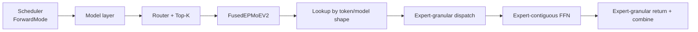
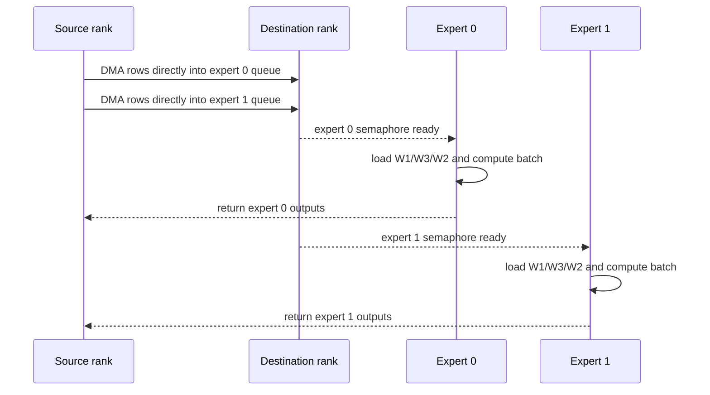
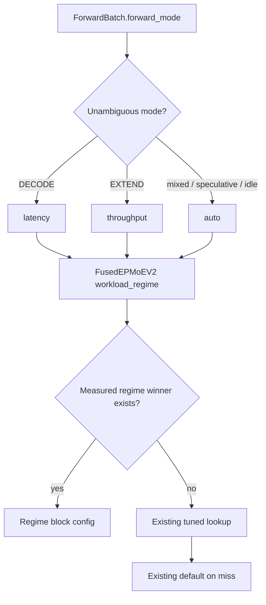
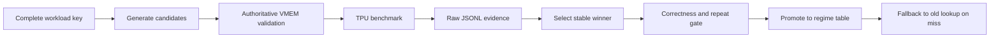

# Fused MoE v2 workload specialization design

## Status

**Last updated:** 2026-09-28 UTC

CPU-testable plumbing is implemented. `ForwardBatch.forward_mode` now reaches
the v2 tuned-config lookup for every production model that constructs
`FusedEPMoEV2` (GLM-5, MiMo-V2-Flash, Bailing MoE, and Bailing MoE Linear).
The default remains `auto`, all old tuned keys remain valid, and no unmeasured
latency/throughput winner is installed. A clean v6e-4 decode comparison now
passes the exact production-baseline, performance, dispersion, and correctness
gates. The throughput/prefill winner now also passes three-run performance,
dispersion, exact-production-baseline, provenance, and correctness gates. The
static table remains unchanged until the separate real-model acceptance gate;
the regime table additionally requires a demonstrated same-key phase collision.

The MiMo-V2-Flash-shaped v6e-16 microbenchmark milestone is now complete on a
`tpu-v6e-16` (`4x4`, four hosts) slice. The exact synthetic shape was
`E=256,H=4096,I=2048,Top-K=8`, routed FP8 block-wise weights, BF16 outputs,
activation quantization, expert A2A, and `EP=16`. At `T=2048`, three
independent random-routing runs measured production-fallback p50s of
1.375255/1.381356/1.382569 ms and static-candidate p50s of
0.526846/0.526896/0.526772 ms. Their across-run means are 1.379727 versus
0.526838 ms: a 61.82% latency reduction (2.619x speedup) for
`(128,1024,80,256,80)` versus `(32,512,32,256,32)`. Under the deliberately
skewed `hot_expert` stress pattern, the same comparison was 6.218 ms versus
3.117 ms, a 49.9% reduction. Raw four-host logs and JSONL are retained under
`mtp-run/fused-moe-tuning-20260928/v6e16-mimo/`.

The immediate cause of the weak v6 fallback is now explicit:
`TUNED_BLOCK_CONFIGS` has a `TPU v7` table and wildcard fallback but no
`TPU v6e` table. Nothing is structurally wrong with the existing static lookup;
the missing work is v6-specific measurement and qualification. The existing
token-count keys already encode most decode-versus-prefill specialization: a
decode step contributes approximately one row per active request, whereas an
extend/prefill step contributes a chunk of prompt rows. On this EP=16 test,
`T=128` leaves only eight rows per rank, so effective `bt/bts/btc` collapse and
`bf=256` through 2048 produced less than 1% separation (`bf=128` was about 8%
slower). At
`T=2048`, each rank owns 128 source rows, and the larger
`bt=128,bts=btc=80,bf=1024` layout materially reduces repeated block work.

The dimensions and quantization match the
[official MiMo-V2-Flash config](https://huggingface.co/XiaomiMiMo/MiMo-V2-Flash/blob/main/config.json):
`hidden_size=4096`, routed `moe_intermediate_size=2048`, 256 routed experts,
Top-K 8, and dynamic block-wise FP8 with 128x128 weight blocks. This still
proves a stable synthetic-kernel result, not yet a real MiMo serving result: an
unchanged server has not loaded a checkpoint and reported its actual token
buckets, full lookup keys, and resolved tuples. The next milestone is
real-model qualification. It keeps fused-v2's
existing expert-granular communication path, activation, quantization, and
shared-expert behavior fixed. The v6e-16 static result is a candidate for the
repository's already-existing shape-keyed table under the normalized device
name `TPU v6e` (`get_device_name()` maps JAX's `TPU v6 lite` to `TPU v6e`). It
is not evidence by itself that a new phase-aware table is necessary. Phase
awareness requires a real same-key
collision: the same model/token bucket must need different winners in decode
and extend because their route distribution or serving objective differs.
Until that is measured, `REGIME_TUNED_BLOCK_CONFIGS` remains empty and `auto`
continues to preserve the pre-existing lookup.

The implementation follows the configuration-driven measured-config lifecycle
used by MegaBlox GMM v2. This does **not** call GMM v2
from the fused kernel and does not force the fused knobs into GMM's
`(tile_m, tile_k, tile_n)` schema. The reusable idea is: generate feasible
candidates, benchmark a complete workload key, retain the raw evidence, and
promote only the measured winner into a small production lookup table.

The CPU-side tuning foundation is now implemented: kernel scratch geometry and
benchmark VMEM pruning share one pure model, structured evidence records exact
stage/provenance/p50/p95/resolved configuration/VMEM headroom, and an offline
selector enforces sample, independent-run, dispersion, p50, p95, and correctness
gates without modifying the production table. The selector now also refuses
promotion unless the baseline record explicitly matches the production-resolved
block config. Exact-baseline decode and throughput qualification now pass on
the v6e-4 synthetic shape. Compiler-budget calibration is implemented from the
observed failures; its TPU confirmation remains. The regime contract, selector,
and VMEM-model CPU suites currently pass 43 tests.

The evidence path now retains configuration-rejection, compilation/execution,
and no-timing failures rather than silently dropping them. Selection summarizes
each independent run first, then takes the median of run p50/p95 values, so a
run with more iterations cannot dominate the decision. It separately gates
cross-run p50 variation and worst within-run variation. With `BENCH_CHECK=1`,
the benchmark checks the fastest measured configuration for each token count
and appends an explicit correctness-only record for that exact resolved config.

The E2 tail experiment is also implemented behind the static default
`tail_aware_btc=False`. It preserves a fixed `btc` dot shape but dynamically
shortens the loop for an expert's final partially occupied `bts` tile. The
benchmark accepts `BENCH_TAIL_AWARE_BTC=0,1`, keeps the variants separate in
selection, and records modeled static/tail btc-group counts. This code is not
enabled by any production caller. TPU compile, correctness, and latency evidence
now validate the mechanism, but not a production default. On the v6e-16 MiMo
shape, tail awareness improved the identical `(128,1024,32,256,128)` layout
from 0.705 ms to 0.519 ms under random routing (26.4%) and from 3.240 ms to
3.083 ms under hot-expert routing (4.8%). However, those results beat the best
static layout by only 1.5% and 1.1%, respectively. Tail awareness therefore
remains default-off and is not yet justified as a separate production feature.

The first TPU VM was reached through `ssh moe`. On 2026-09-27 UTC, a v6e-4
configuration-only decode sweep completed in an isolated remote worktree. The
three-run performance gate passed with a 23.84% p50 improvement and numerical
correctness from clean commit `f83a295bf3f7161b0d69932c2e2a0bd555d1d63f`.
Raw logs, JSONL, and the selector report are retained under
`mtp-run/fused-moe-tuning-20260927/clean-f83a295b/`. The run compared two
explicit configs: its `(32,256,32,256,32)` baseline is not the production
fallback `(32,512,32,256,32)`. It proves the candidate is valuable, but the
strengthened selector correctly reports `promotion_ready=false`; no latency
entry is installed. A subsequent prefill run recorded its baseline, but
GCP placed the TPU in `UNHEALTHY_MAINTENANCE` before candidate timings began.
The old node was subsequently removed, and the project currently lists neither
an active TPU VM nor a queued replacement. The completed clean decode artifacts
were synchronized locally before removal; the prefill baseline number was
observed in the run log but its remote artifact was not recovered.

A later externally provided v6e-4, reached through `ssh moe_2`, completed the
missing exact-baseline work from clean commit
`477b8b326eb3496f76326aac88350534965c408b`. Three independent decode pairs
compared the production fallback `(32,512,32,256,32)` with
`(32,256,64,256,64)`: median p50 fell from 0.448601 ms to 0.336544 ms
(24.98%), median p95 fell from 0.449901 ms to 0.337331 ms (25.02%), and all
correctness checks passed. The selector reports `performance_gate_passed=true`
and `promotion_ready=true`. Evidence was copied immediately to
`mtp-run/fused-moe-tuning-20260927/moe_2-exact-477b8b32/decode-exact/`.

The same VM completed the first bounded `T=4096` throughput sweep. The exact
production fallback `(32,512,32,256,32)` measured 18.692389 ms p50 and
19.326512 ms p95. Of 12 diverse candidates, seven executed and five failed
compiler scoped-VMEM allocation. The best successful point was
`(128,256,160,256,160)`, measuring 3.988682 ms p50 in the sweep and
3.983270 ms p50 in a dedicated follow-up (about 78.7% below the production
fallback). A later clean follow-up with the grouped reference passes full-shape
correctness (`max_abs=0.0020`, relative error 0.003676, tolerance 0.05) at
3.983 ms p50. Three same-commit baseline and candidate runs now pass the
selector with `promotion_ready=true`; the result is ready for real-model A/B.
The five compiler failures also prove that the
logical estimator is not authoritative: it admitted candidates estimated below
64 MiB whose compiler allocations were 65.63-94.60 MiB. Raw evidence is under
`mtp-run/fused-moe-tuning-20260927/moe_2-exact-477b8b32/prefill/`.

After final qualification, all 52 remote evidence files were copied to
`mtp-run/fused-moe-tuning-20260927/moe_2-remote-final/`. The Sky cluster was
then terminated; `sky status moe_2` reports the cluster absent.

This work specializes selection and measurement. It does not switch the
production communication protocol away from the existing `expert` mode.

## Scope lock for the v6e-16 milestone

The optimization target is the expert-FFN compute layout inside fused MoE v2:

| Knob | Kernel meaning | Expected benefit | Main cost or constraint |
|---|---|---|---|
| `bt` | Outer local-token block used by routing, scatter/gather, and the pipeline | Fewer outer rounds and more rows available to each expert per round | Larger communication/output scratch; must divide the local token count after resolution |
| `bts` | Maximum expert rows staged in VMEM for one expert-FFN tile | Reuse one staged token tile across more `bf` weight tiles | Token, gate/up, and output scratch grow with `bts`; `bts <= bt * EP` |
| `btc` | Fixed row count of each MXU compute tile | Fewer compute groups when experts have enough rows | More padding for small/ragged expert loads; multiple of 8 and divides `bts` |
| `bf` | Intermediate-dimension slice of W1, W3, and W2 | Fewer weight-slice iterations and more work per load | Double-buffered weights and FFN intermediates grow with `bf`; multiple of 128 and divides the model intermediate size |
| tail-aware `btc` | Shorten the final `btc` loop to skip groups with zero valid rows | Removes entirely empty fixed-shape MXU groups when `btc < bts` | Dynamic control may reduce compiler unrolling/pipelining; cannot remove padding inside the final non-empty `btc` tile |

For `r` routed rows of one expert in one outer block, the relevant work counts
are:

```text
outer blocks                 = local_num_tokens / bt
intermediate slices          = intermediate_size / bf
static btc groups            = ceil(r / bts) * (bts / btc)
tail-aware btc groups        = ceil(r / btc)
```

The experiment holds `bse` fixed at the production-resolved value, because the
current MiMo target does not need a shared-expert study to answer the four-knob
question. It also holds `a2a_mode=expert` fixed. Rank dispatch/combine, prefill
weight-loop restructuring, lower-precision changes, and other communication
protocols are deferred until this milestone identifies the remaining exposed
cost. This prevents a serving win from being incorrectly attributed to several
simultaneous changes.

### Three features, tested independently

The repository already selects static fused-v2 block configurations from
`TUNED_BLOCK_CONFIGS`; that capability is not new. The current work contains
three related activities, but only one introduces new executed kernel work:

| Feature | What changes | Independent comparison | Interpretation |
|---|---|---|---|
| A. Static layout qualification | The exact `(bt,bf,btc,bse,bts)` tuple using the existing kernel and lookup model | Production-resolved tuple versus an explicitly supplied candidate, with tail awareness off | Finds a missing measured table entry; it is not a new kernel execution path |
| B. Workload-regime selection | Which existing static tuple the caller selects | Explicit candidate versus the identical tuple selected through `DECODE`/`EXTEND`; also test `AUTO` fallback | New selection metadata, not another kernel speedup; requires a same-key phase collision to justify production entries |
| C. Tail-aware execution | The final `btc` loop count | Identical tuple and routes with tail awareness off versus on | Measures only skipped empty compute groups |

The measurements must report A and C separately. The combined serving candidate
is tested last, but its improvement is not described as `A + B + C`: B merely
selects A automatically, and A/C may interact through the winning `btc/bts`
shape.

Use this ablation order:

```text
A0: explicit production-resolved tuple, static tail loop
A1: explicit tuned tuple,              static tail loop   -> A1 - A0 = layout
B1: same tuned tuple selected by ForwardMode/regime       -> must match A1
C1: same tuned tuple and routes,       tail-aware loop    -> C1 - A1 = tail
ALL: natural ForwardMode selection plus qualified tail    -> serving confirmation
```

If the best A1 has `btc=bts`, C has no empty `btc` groups to remove and should
stop rather than being forced into the serving experiment.

The existing table also disproves a power-of-two-only rule. Of its 48 measured
entries, 14 contain at least one non-power-of-two block dimension. Existing
values include `40`, `48`, `56`, `72`, `80`, `96`, `112`, `160`, `216`, and
`856`; `80` occurs four times. The kernel requirement is alignment and layout
legality, not power-of-two shape: candidate `btc` values are 8-row-aligned
divisors of `bts`, and `bts % btc == 0`. Non-power-of-two rows can match routed
expert load more closely and avoid either a second resident tile or excessive
padding. For the MiMo block, expected rows per expert are
`128 * 16 * 8 / 256 = 64`; the tuner also tests the 25%-headroom point 80.
Measured `64/64` was 0.725 ms, while `80/80` was 0.529 ms in the same sweep.

Hidden size is already part of both the lookup key and VMEM calculation. With
FP8 expert weights, the three double-buffered W1/W3/W2 tiles consume roughly
`6 * hidden_size * bf` bytes, before scale and activation scratch. Token/output
scratch also grows with `bts * hidden_size`, while gate/up scratch grows with
`bts * bf`. A larger hidden size therefore generally lowers the feasible `bf`
and `bts` frontier, but does not determine the performance winner. On the MiMo
shape, `bf=2048,bts=128` was rejected at an estimated 65.0 MiB against the
60.8 MiB tuning budget; at `bts=80`, both `bf=1024` and `2048` ran, and the
smaller `bf=1024` was still faster (0.529 ms versus 0.537 ms).

Current implementation status:

| Feature | Code status | Production status |
|---|---|---|
| Static layout tuning | Existing production lookup plus candidate generation, VMEM pruning, JSONL evidence, selector, and v6e-4/v6e-16 synthetic winners | Three-run v6e-16 kernel repeatability passes; no `TPU v6e` entry is installed pending real-model qualification |
| Workload-regime selection | `ForwardMode` mapping and fallback lookup are implemented and CPU-tested | Tables are empty; same-token-bucket phase evidence is still missing, and `auto` preserves old behavior |
| Tail-aware execution | Kernel/benchmark path, v6e-4 correctness, and v6e-16 performance ablations exist | Default off; only 1.1-1.5% ahead of the best static layout in current v6e-16 tests |

## Problem statement

The v2 kernel already selects `(bt, bf, btc, bse, bts)` from normalized device
name, tensor dtype, weight dtype, token count, model shape, quantization flags,
and EP size. Token count is useful but ambiguous: 512 rows can
be a large continuous-batching decode step, a short prefill, or a mixed batch.
These workloads have different objectives:

- latency-oriented decode minimizes exposed per-step latency;
- throughput-oriented prefill amortizes weight/control cost over more rows and
  maximizes sustained MXU utilization;
- mixed and speculative modes need data before being assigned to either.

The earlier rank-dispatch experiment also showed why phase matters. It removed
logical communication rows, but packed/unpacked a ragged rank inbox and lost
expert-granular readiness. Every measured candidate was slower than the current
expert pipeline. A byte reduction alone is not an acceptance gate.

## Current pipeline



Before this change, `ForwardMode` stopped at the model layer. The lookup could
not distinguish decode from prefill when their row counts matched.



DMA destination addresses perform expert grouping during transfer. The receiver
gets contiguous rows without another reorder, and one expert can compute while
later experts are still receiving.

## Improvement axes

| Axis | Current limitation | Candidate | Gate |
|---|---|---|---|
| Workload selection | Token count is a phase proxy | Explicit `auto`, `latency`, `throughput` | CPU contract + TPU winner |
| Expert compute | One tile winner per shape | Joint `bt`, `bts`, `btc`, `bf` regime sweeps | Whole-kernel and serving time |
| Tail compute | Fixed loop may execute empty tiles | Default-off dynamic final-loop bound | Beat the best static config, not only a deliberately padded config |
| VMEM feasibility | Logical estimate can admit compiler OOMs | Calibrated prune plus actual compile result | No compiler OOM and measured headroom |
| Observability | Aggregate time hides the responsible phase | Resolved config, route histogram, work counts, trace regions | Explain the measured serving delta |

Communication and weight-loop changes are not part of this milestone. Modeled
work counts are explanatory data, not substitutes for device or serving time.

## Proposed selection path



The regime supplements the complete old shape key; it never replaces token
count or model architecture. Activation remains a kernel/model contract. If
measurements show activation-specific winners, activation must be added to the
tuning key before installing them.

### Shape-keyed configuration table

Yes, different model architectures can require different winners. The lookup is
therefore keyed by execution shape rather than by a model-name string:

```text
REGIME_TUNED_BLOCK_CONFIGS[regime][device][
  activation_dtype,
  weight_dtype,
  num_tokens,
  num_experts,
  top_k,
  hidden_size,
  intermediate_size,
  ep_size,
  use_shared_expert,
  use_grouped_topk,
  enable_activation_quantization,
  quantization_mode,
] -> (bt, bf, btc, bse, bts)
```

This gives the desired model specialization without unnecessarily duplicating
entries: two model names with the same relevant architecture, dtype,
quantization, topology, token bucket, and workload regime can share a measured
configuration. Conversely, MiMo EP=16 does not reuse a v6e-4 BF16 result whose
expert count, dimensions, precision, token bucket, or EP size differs.

The initial MiMo entry is exact-match only. On a miss, the selector falls back
to the existing tuned table and then the current default; it does not choose the
"nearest" model shape. Activation function is not in the current key. MiMo uses
SiLU, so this is unambiguous for the first entry; before sharing a measured key
with a model using another expert activation, add activation to the key or prove
that the winner is unchanged.

The regime dimension provides these policies:

| Forward mode | Regime | Initial strategy |
|---|---|---|
| Plain `DECODE` | `latency` | Measured small/ragged-row winner; usually favors less padding and lower step latency |
| Plain `EXTEND` | `throughput` | Measured large-row winner; can use larger resident/compute tiles to amortize control and weight movement |
| Mixed, speculative/verify, idle, or unknown | `auto` | Skip the regime override and preserve the existing tuned lookup/default |

These are selection policies, not hard-coded tile formulas. The TPU sweep still
decides the actual tuple for each exact key. `auto` is intentionally a safe
fallback in this milestone, not a third newly tuned strategy. If mixed or verify
traffic later has enough evidence for a distinct winner, add an explicit regime
rather than teaching `auto` to guess.

## Concrete implementation

1. `MoeWorkloadRegime` defines `auto`, `latency`, and `throughput`.
2. `FusedEPMoEV2.__call__` forwards the optional regime only to block selection;
   the Pallas ABI is unchanged.
3. Production callers map only plain `DECODE` to `latency` and plain `EXTEND`
   to `throughput`. Mixed/speculative modes remain `auto`.
4. `REGIME_TUNED_BLOCK_CONFIGS` is checked first for a non-auto regime; a miss
   falls through to all existing lookup levels.
5. A regime table entry is installed only after a clean TPU sweep satisfies the
   repeated-run, correctness, dispersion, p50, and p95 gates.
6. `bench_v2.py` accepts `BENCH_WORKLOAD_REGIME` and records it in JSONL.
7. CPU tests use synthetic entries for lookup-contract coverage; the production
   regime tables remain empty until real-model qualification.

### GMM-v2-inspired measured-config lifecycle

GMM v2 has a deliberately small lookup keyed by device, dtypes, group count,
and matrix shape. Fused MoE should adopt that workflow, but keep its native
configuration because its knobs cover communication and scheduling as well as
matrix multiplication:

```text
GMM v2 value:       (tile_m, tile_k, tile_n)
Fused MoE v2 value: (bt, bf, btc, bse, bts)
```

The concepts are related but not interchangeable:

| GMM concept | Closest fused concept | Important difference |
|---|---|---|
| `tile_m` | `btc` | `bts` also controls resident expert rows |
| `tile_k` | hidden/reduction slicing | Fused v2 currently derives this from layout and quantization |
| `tile_n` | `bf` | `bf` also sizes three weight buffers and FFN intermediates |
| groups and `group_sizes` | experts and routed rows | Fused v2 receives rows incrementally with expert semaphores |

Do not create a common runtime config class merely to make these tuples look
the same. Share the tuning lifecycle and result format instead:



The complete fused key must retain device generation, activation and weight
dtypes, quantization mode, token count, model dimensions, expert count, Top-K,
EP size, shared-expert/grouped-routing flags, and workload regime. A future
communication protocol may extend the key with `a2a_mode`, but the current
configuration sweep keeps `expert` fixed so compute-layout results are not
confounded with the failed rank-packing experiment.

Raw evidence does not belong in `tuned_block_configs.py`. Store the command,
git revision, device topology, candidate list, compile failures, VMEM estimate,
all timing samples, p50/p95, correctness result, and selected winner in the
benchmark artifact. The production table contains only reviewed winners and a
short provenance comment.

### Repository prior art to reuse

The fused-MoE design must be checked against sibling TPU kernels before adding
new tuning infrastructure. The current repository already contains these
applicable patterns:

| Existing implementation | Pattern to reuse in fused MoE |
|---|---|
| GMM v2 tuned tiles | Exact device/dtype/shape key, measured value, conservative miss |
| Ragged paged attention v3 | Stage-specific keys for decode, prefill, mixed, and verify |
| MLA v2 | Stage-specific lookup with a Mosaic-legal fallback and logged misses |
| Quantized matmul | Typed key/value records plus post-lookup clamping and sublane-alignment validation |
| mHC | Pure, unit-testable platform capability and VMEM-cost functions |
| Fused MoE v2 named scopes | Existing scatter/wait/weight-load/FFN/store/gather trace regions |

This changes several details of the plan:

- Record the exact scheduler `ForwardMode` in every tuning artifact. The public
  selection can continue to use `latency`, `throughput`, and safe `auto`
  fallback initially, but mixed and speculative verification must not be
  silently treated as measured decode or prefill winners.
- Validate every table hit after lookup. A measured tuple for a nearby shape is
  not automatically Mosaic-legal for the current row count, dtype, or
  quantization layout. Do not add nearest-neighbor reuse until those legality
  rules and performance are tested.
- Follow mHC's structure for VMEM accounting: one pure shape/cost builder used
  by candidate generation and unit tests. The fused kernel and benchmark both
  currently request a 64 MiB compiler limit, while other kernels encode
  different generation-specific budgets. Resolve the intended fused-kernel
  budget explicitly rather than copying another kernel's number.
- Do not add duplicate trace markers. The fused kernel already names metadata,
  scatter, receive waits, W1/W3/W2 loads and waits, FFN stages, stores, gather,
  and accumulation. E0 needs trace capture and aggregation of those regions,
  adding markers only for an observed blind spot.

### Immediate v6e-16 execution sequence

The CPU plumbing, evidence schema, selector, v6e-4 configuration sweep, and
default-off tail-aware kernel variant are complete. Target provisioning, exact
MiMo-shape static tuning, VMEM filtering, random/hot routing comparison, and
the paired tail-aware microbenchmark are also complete. Remaining work starts
with the unchanged real-model server smoke and same-token-bucket phase evidence:

1. **Freeze the target and evidence identity. [complete for the microbenchmark]** Record the local and remote git
   commits, model revision, four host names/internal IPs, TPU topology, JAX/libtpu
   versions, launch command, and compilation-cache directory. Use the same
   commit and model files on all hosts. Copy logs and JSONL to
   `mtp-run/fused-moe-tuning-20260928/v6e16-mimo/` after every completed cell;
   the TPU VM is treated as ephemeral.
2. **Start an unchanged fused-v2 smoke server.** Copy the documented v6e-16
   MiMo profile, change only `--moe-backend fused` to `fused_v2`, and explicitly
   keep `--fused-moe-a2a-mode expert`. Use the smaller-context launch only to
   find startup/correctness issues; no number from it is a performance result.
3. **Discover the real compiled keys.** From server logs and one trace, capture
   MiMo's loaded hidden/intermediate/expert/Top-K/quantization values, the actual
   decode and extend `num_tokens` buckets, resolved `(bt,bf,btc,bse,bts)`, routed
   rows per local expert, and compiler VMEM allocation. Do not infer these keys
   from the v6e-4 BF16 synthetic shape.
4. **Re-run the microbenchmark on v6e-16 using those exact keys. [complete for the T=2048 synthetic key]** First compare
   the production-resolved static config with feasible static candidates. Tune
   latency and throughput buckets separately, with `bse`, communication, route
   seed/distribution, quantization, and model dimensions fixed. Compile every
   candidate before timed runs; retain compile failures as evidence.
5. **Run a paired tail-aware ablation. [complete for random and hot-expert routing]** For every promising `btc < bts`
   candidate, compare `tail_aware_btc=0` and `1` with all block fields and routes
   identical. Also include the best static config even if `btc=bts`. Tail-aware
   wins only if it beats that best static point; rescuing a poor padded point is
   not sufficient.
6. **Create a reviewable qualification patch.** First put the measured static
   key in the existing `TUNED_BLOCK_CONFIGS["TPU v6e"]` table; do not use the
   raw JAX device string `TPU v6 lite`, because `get_device_name()` normalizes
   it to `TPU v6e`. Add a regime-specific key only if step 3 exposes a genuine
   same-complete-key phase collision. If tail awareness wins step 5, add a
   separately default-off server/config field with CPU propagation tests so the
   real model can select it explicitly.
7. **Run the real-model matrix.** Compare the old production lookup with the
   candidate selected naturally from the existing static table and, only if it
   won step 5, a tail-aware variant. Assert that the server logs the exact
   candidate tuple before accepting its serving data. Add a phase-selected row
   only when a same-key collision was established in step 3.
   Keep the existing v1 `fused` recipe as a reference row, not the primary A/B.
   Use the exact production context/cache/scheduler settings for measured runs,
   warm each compiled shape, and run each measured cell three times.
8. **Promote conservatively.** Put an ordinary winner only under its exact
   static token/architecture/quantization key. If the same-key collision is
   proven, a decode-only winner may populate `latency` and a prefill-only winner
   may populate `throughput`. Tail-aware remains default-off unless its separate
   real-model gate passes. Do not add a wildcard or nearest-shape entry from
   this experiment.

## High-level data

### MiMo-shaped v6e-16 microbenchmark (2026-09-28)

Target: TPU v6 lite, 16 chips across four hosts, `E=256,H=4096,I=2048`,
Top-K 8, FP8 block-wise weights, activation quantization, expert A2A, and
`T=2048` (`128` input rows per chip). All reported cells compiled and executed
on all four hosts; multi-host timing runs do not claim per-config oracle parity.
The tail-aware mechanism has separate single-host v6e-4 oracle coverage.

| Routing | Variant | `(bt,bf,btc,bse,bts)` | Tail | p50 | Change versus production |
|---|---|---|---:|---:|---:|
| Random | Production lookup, across-run mean of p50 | `(32,512,32,256,32)` | off | 1.380 ms | control |
| Random | Best static, across-run mean of p50 | `(128,1024,80,256,80)` | off | 0.527 ms | 61.82% lower |
| Random | Same padded tail layout | `(128,1024,32,256,128)` | off | 0.705 ms | 48.7% lower |
| Random | Same padded tail layout | `(128,1024,32,256,128)` | on | 0.519 ms | 62.3% lower |
| Hot expert | Production lookup | `(32,512,32,256,32)` | off | 6.218 ms | control |
| Hot expert | Best static | `(128,1024,80,256,80)` | off | 3.117 ms | 49.9% lower |
| Hot expert | Same padded tail layout | `(128,1024,32,256,128)` | off | 3.240 ms | 47.9% lower |
| Hot expert | Same padded tail layout | `(128,1024,32,256,128)` | on | 3.083 ms | 50.4% lower |

Static tuning is the material result. Tail awareness removes 26.4% from its
matched random-routing padded layout and 4.8% from its matched hot-expert
layout, but it beats the best static tuple by only 1.5% and 1.1%. The static
candidate has passed three-run kernel repeatability and therefore proceeds to
real-model qualification;
tail awareness remains an optional ablation.

The repeat p50s were baseline
`1.375255/1.381356/1.382569 ms` and candidate
`0.526846/0.526896/0.526772 ms`. This narrow candidate range is strong evidence
for the block-layout result, but it does not replace a server startup,
checkpoint correctness, or serving-level A/B test. The current four hosts each
have 83 GiB free while the MiMo-V2-Flash Hugging Face snapshot is approximately
313 GB, and the loader calls `snapshot_download()` before iterating local
safetensors. Real-model work therefore needs a larger/shared checkpoint volume
or a supported smaller fused-v2 MoE checkpoint; a dense Gemma checkpoint would
not exercise this kernel.

The offline selector reports `performance_gate_passed=true`: median-of-run p50
is 1.381356 versus 0.526846 ms (61.86% lower), with run-p50 CV 0.232% versus
0.0096%. It intentionally reports `promotion_ready=false` because these
multi-host records have no explicit oracle result and were produced from a
dirty experimental revision. Both are qualification gaps, not performance
failures. The generated report is
`mtp-run/fused-moe-tuning-20260928/v6e16-mimo/repeat-selection-report.json`.

The VMEM filter rejected five `bf=2048,bts=128` variants at 65.0 MiB against a
60.8 MiB tuning budget before Mosaic compilation. Every selected candidate that
was submitted compiled and executed. The first distributed launch attempt is
archived separately: it forced the wrong JAX coordinator mapping and timed out
before compilation, so it is launcher-failure evidence, not a VMEM or kernel
result. A later attempt to run one host from the multi-host slice was also
stopped after JAX reported that TPU backend initialization requires all hosts.

### Measured v6e-4 synthetic results

One-rank routing, BF16, `E=32`, Top-K 8, `I=1024`:

| Rows | H | Mode | Device time | Change vs expert |
|---:|---:|---|---:|---:|
| 128 | 1,024 | expert | 0.071 ms | control |
| 128 | 1,024 | packed rank dispatch | 0.106 ms | +49.3% slower |
| 128 | 1,024 | rank dispatch + combine | 0.108 ms | +52.1% slower |
| 128 | 8,192 | expert | 0.328 ms | control |
| 128 | 8,192 | packed rank dispatch | 0.337 ms | +2.7% slower |
| 512 | 8,192 | expert | 1.258 ms | control |
| 512 | 8,192 | packed rank dispatch | 1.334 ms | +6.0% slower |

These are initial synthetic measurements, not three-run qualification. They
show packing cost and lost readiness can exceed communication savings.

### Three-run configuration-only decode result

This experiment held `a2a_mode=expert`, routing, weights, model shape, and all
algorithmic flags fixed. It changed only the existing block configuration.
Shape: BF16, `T=128`, `H=8192`, `I=1024`, `E=32`, Top-K 8, EP=4 on v6e-4.
Each independent run contains 20 device-trace samples.

| Variant | `(bt,bf,btc,bse,bts)` | Median run p50 | Median run p95 | Worst run p95 | Run-p50 CV |
|---|---|---:|---:|---:|---:|
| Controlled baseline | `(32,256,32,256,32)` | 0.442208 ms | 0.442766 ms | 0.442773 ms | 0.0143% |
| Measured winner | `(32,256,64,256,64)` | 0.336801 ms | 0.337180 ms | 0.337319 ms | 0.0487% |

The winner improves p50 by **23.84%**, median p95 by **23.85%**, and worst-run
p95 by **23.82%**. Its maximum within-run CV is 0.1207%. Correctness passed
with max absolute error 0.0020 and relative error 0.00556 at tolerance 0.05.
The result validates that workload-specific block tuning has substantial value
before any new transport or tail-loop implementation. In particular, the useful change is the larger
`btc/bts=64` expert-row window; increasing `bf` was not responsible because the
otherwise similar `bf=512` point was slightly slower at 0.339888 ms p50 in the
initial dirty sweep.

That first comparison was not production-relative because the exact current
fallback is `(32,512,32,256,32)`. The completed follow-up at clean commit
`477b8b32` fixes that gap:

| Variant | `(bt,bf,btc,bse,bts)` | Median run p50 | Median run p95 | Result |
|---|---|---:|---:|---:|
| Production fallback | `(32,512,32,256,32)` | 0.448601 ms | 0.449901 ms | control |
| Qualified winner | `(32,256,64,256,64)` | 0.336544 ms | 0.337331 ms | 24.98% / 25.02% faster |

Both variants have three clean independent runs with 20 trace samples per run,
and all correctness checks pass. The selector artifact at
`mtp-run/fused-moe-tuning-20260927/moe_2-exact-477b8b32/decode-exact/selection.json`
reports `performance_gate_passed=true`, `promotion_ready=true`, and no promotion
gate reasons. This qualifies the configuration for the synthetic decode key;
it does not replace the separate real-model acceptance gate.

### Throughput/prefill sweep

At `T=4096,H=8192,I=1024,E=32,Top-K=8,EP=4`, `EXTEND`/`throughput`, the exact
production fallback `(32,512,32,256,32)` measures 18.692389 ms p50 and
19.326512 ms p95. The bounded tuner generated 160 logically VMEM-valid
candidates, selected 12 across 17 `bt/bts` buckets, and produced seven timings.
The best point was `(128,256,160,256,160)` at 3.988682 ms p50; a dedicated
follow-up measured 3.983270 ms p50 and 3.985662 ms p95. The final same-commit
three-run comparison has production median p50/p95 of 18.734134/19.172657 ms
and winner median p50/p95 of 3.982071/3.985314 ms: **78.74% p50** and
**79.21% p95** improvement. Both variants pass correctness; the selector
reports `performance_gate_passed=true`, `promotion_ready=true`, and no gate
reasons. This clears the synthetic gate and is ready for real-model A/B.

Five candidates failed compilation even though the logical estimate placed
them below the 64 MiB limit. Mosaic reported 65.63, 68.44, 72.82, 81.62, and
94.60 MiB scoped allocations. The estimator now preserves the exact logical
total but adds a calibrated 1.20x expert-working-set allowance for compiler
budgeting; CPU regressions show it rejects all five observed OOM shapes while
retaining every observed successful shape. A TPU rerun must confirm that filter
before widening the sweep. The current winner passes full-shape correctness
and repeated independent baseline/candidate timing. The
original sweep artifacts are under
`mtp-run/fused-moe-tuning-20260927/moe_2-exact-477b8b32/prefill/`; the grouped
correctness record is under
`mtp-run/fused-moe-tuning-20260927/moe_2-exact-2a7ab5e/prefill/`, together with
the final `selection.json`.

### Logical byte opportunity

```text
expert_rows = T * K
rank_rows = T * mean_unique_destination_ranks
saved_bytes = T * (K - mean_unique_destination_ranks) * H * 2
payload_time_ms = remote_saved_bytes / effective_bytes_per_second * 1e3
```

At `T=128`, uniform EP=4 routing gives these payload-only ceilings:

| Model | H / Top-K / MoE layers | Global remote saving/layer | Balanced critical-chip bytes | 100-400 GB/s critical-chip time | Fully exposed model ceiling |
|---|---|---:|---:|---:|---:|
| DeepSeek-V3 | 7,168 / 8 / 58 | about 5.76 MiB | about 1.44 MiB | 0.0151-0.00377 ms | 0.875-0.219 ms |
| MiMo-V2-Flash | 4,096 / 8 / 47 | about 3.29 MiB | about 0.82 MiB | 0.00862-0.00216 ms | 0.405-0.101 ms |

The time column uses the critical chip, not the global byte total. The
model-wide number is optimistic: transfer must be balanced and fully exposed at
every layer. Overlap with weight DMA or MXU work reduces the saving. A fresh
seed-42 CPU route trace at `T=128` produced 1.67 MiB (DeepSeek shape) and
0.95 MiB (MiMo shape) on the busiest source/destination chip, corresponding to
0.0175-0.00437 ms and 0.00999-0.00250 ms at the same bandwidth scenarios.

## Experiment design

### E0: attribution before another transport rewrite

Record scatter, exposed receive-semaphore waits, W1/W3/W2 DMA, MXU, return DMA,
output combine, modeled rows/starts, and whole-kernel time on one time axis.
Compare identical local-only and shifted-remote routing. If remote placement
does not increase exposed time, communication deduplication is not next.

### E1: workload-regime tile sweep

Sweep feasible `(bt, bf, btc, bse, bts)` after authoritative VMEM pruning.
Alternate order, use at least two warmups and 20 timed samples, and report
p50/p95 plus dispersion against the current `auto` winner.

| Workload | Rows | Primary metric | Models |
|---|---:|---|---|
| Decode | 32, 64, 128, 256, 512 | p50/p95 latency | MiMo, GLM-5.2 |
| Crossover | 512, 768, 1,024 | latency-throughput Pareto frontier | MiMo, GLM-5.2, Ling |
| Prefill | 2,048, 4,096, 8,192, 16,384 | rows/s and kernel time | MiMo, GLM-5.2, Ling |

#### First reproducible v6e-4 sweep

Run from a clean commit in the repository root. These commands deliberately
hold `a2a_mode=expert` fixed. They compare the production-selected config with
configuration-only tuning at the already exercised synthetic shape before any
tail-loop, weight-reuse, or communication code change.

```bash
artifact_dir=/tmp/fused-moe-e1-decode
mkdir -p "$artifact_dir"
for run in 1 2 3; do
  BENCH_TOKENS=128 BENCH_D=8192 BENCH_F=1024 BENCH_E=32 BENCH_TOPK=8 \
  BENCH_A2A_MODE=expert BENCH_FORWARD_MODE=DECODE BENCH_WORKLOAD_REGIME=latency \
  BENCH_ROUTING_MODE=random BENCH_WARMUP=2 BENCH_ITERS=20 BENCH_CHECK=1 \
  BENCH_VARIANT=fused_moe_v2_baseline BENCH_RUN_ID="decode-baseline-$run" \
  BENCH_JSONL="$artifact_dir/baseline-$run.jsonl" \
  python python/sgl_jax/srt/kernels/fused_moe/v2/bench_v2.py
done

for run in 1 2 3; do
  BENCH_TOKENS=128 BENCH_D=8192 BENCH_F=1024 BENCH_E=32 BENCH_TOPK=8 \
  BENCH_A2A_MODE=expert BENCH_FORWARD_MODE=DECODE BENCH_WORKLOAD_REGIME=latency \
  BENCH_ROUTING_MODE=random BENCH_WARMUP=2 BENCH_ITERS=20 BENCH_CHECK=1 \
  BENCH_TUNE=1 BENCH_MAX_CONFIGS=48 \
  BENCH_VARIANT=fused_moe_v2_config_tune BENCH_RUN_ID="decode-tune-$run" \
  BENCH_JSONL="$artifact_dir/tune-$run.jsonl" \
  python python/sgl_jax/srt/kernels/fused_moe/v2/bench_v2.py
done

python python/sgl_jax/srt/kernels/fused_moe/v2/tune_select.py \
  "$artifact_dir"/*.jsonl --output "$artifact_dir/selection.json"
```

Repeat with `BENCH_TOKENS=4096`, `BENCH_FORWARD_MODE=EXTEND`, and
`BENCH_WORKLOAD_REGIME=throughput` for the first prefill comparison. If the
checkout is dirty, the selector still reports a provisional performance result
but intentionally sets `promotion_ready=false`.

### E2: tail-aware compute

Compare the current fixed loop, a static maximum loop with a predicate, a
dynamic loop bound, and optionally finite static tail variants. Reject a
candidate if it saves empty tiles but loses compiler pipelining or latency.

The first implementation compares the current static bound with a dynamic bound:

```text
static groups/expert/block = ceil(rows / bts) * (bts / btc)
tail-aware groups/expert/block = ceil(rows / btc)
```

Both execute fixed-size `btc` matrix multiplications; the experiment removes
only groups containing zero valid expert rows. A seed-42 CPU routing model for
`E=32,Top-K=8,EP=4` predicts:

| T / bt / bts / btc | Static groups | Tail-aware groups | Global reduction | Busiest-rank reduction |
|---|---:|---:|---:|---:|
| 128 / 32 / 64 / 64 (measured decode candidate) | 32 | 32 | 0.0% | 0.0% |
| 128 / 32 / 32 / 8 | 196 | 143 | 27.0% | 32.1% |
| 128 / 32 / 64 / 8 | 256 | 143 | 44.1% | 40.6% |
| 4096 / 128 / 128 / 128 (prefill baseline) | 373 | 373 | 0.0% | 0.0% |
| 4096 / 128 / 128 / 32 | 1,492 | 1,141 | 23.5% | 27.0% |
| 4096 / 128 / 256 / 32 | 2,048 | 1,141 | 44.3% | 43.0% |

These are logical work counts, not predicted latency. They also show that the
measured `btc=bts=64` decode candidate has no tail work to remove. E2 can
help only configurations with `btc < bts`, and its dynamic control overhead and
compiler schedule must be measured. The first TPU comparison is now complete:
at `btc=8,bts=32`, tail awareness reduced p50 from 0.482852 ms to 0.465152 ms
(3.67%); at `btc=8,bts=64`, it reduced p50 from 0.605399 ms to 0.382659 ms
(36.79%). Correctness passed for all four variants. Tail awareness can recover
large losses in a padded configuration, but the overall decode winner remains
the directly tuned `btc=bts=64` point at about 0.337 ms, where there are no
fully empty tail groups to remove.

The first TPU ablation should hold the routing and block shape fixed and vary
only the loop bound:

```bash
BENCH_TOKENS=128 BENCH_D=8192 BENCH_F=1024 BENCH_E=32 BENCH_TOPK=8 \
BENCH_BT=32 BENCH_BF=256 BENCH_BTC=8 BENCH_BTS=32,64 \
BENCH_TAIL_AWARE_BTC=0,1 BENCH_A2A_MODE=expert \
BENCH_FORWARD_MODE=DECODE BENCH_WORKLOAD_REGIME=latency \
BENCH_ROUTING_MODE=random BENCH_WARMUP=2 BENCH_ITERS=20 BENCH_CHECK=1 \
BENCH_JSONL=/tmp/fused-moe-e2-tail.jsonl \
python python/sgl_jax/srt/kernels/fused_moe/v2/bench_v2.py
```

### E3: v6e-16 MiMo real-model qualification

#### Target and controlled variants

Use XiaomiMiMo/MiMo-V2-Flash on `tpu-v6e-16`: four hosts, four chips per host,
`TP=16`, `DP=4`, and `EP=16`. The repository's measured production recipe uses
v1 `fused`; create an experiment profile rather than editing that validated
profile in place.

The controlled comparison is:

| ID | Backend and config | Purpose |
|---|---|---|
| R | v1 `fused`, documented production recipe | Historical serving reference only |
| A0 | `fused_v2`, explicit production-resolved block config, static loop | Primary layout baseline |
| A1 | `fused_v2`, explicit measured v6e-16 tuple, static loop | Isolate the `bt/bts/btc/bf` gain in the microbenchmark |
| B1 | `fused_v2`, natural `ForwardMode` selects the same A1 tuple, static loop | Verify decode/prefill regime selection end to end; performance should match A1 |
| C1 | Same tuple/routes as A1/B1, tail-aware loop | Isolate tail-aware behavior; run only when `btc < bts` |

All variants use expert A2A. A0, A1, B1, and C1 must otherwise use identical
model, prompt, scheduler, cache, quantization, and launch settings. A1 versus A0
is the static-layout delta. B1 must resolve to the same tuple and reproduce A1;
it does not create an additional speedup. C1 versus A1 is the tail delta. R
versus A0 is useful backend context but must not be presented as a block-tuning
result.

The cookbook and nightly profile currently disagree on v6e-16 chunked prefill
(`2048` versus `4096`) and static-memory fraction (`0.95` versus `0.90`). Use the
cookbook's validated production command for final results:

```text
page_size=256, context_length=262144, chunked_prefill_size=2048,
mem_fraction_static=0.95, swa_full_tokens_ratio=0.20,
max_running_requests=128, attention_backend=fa, dp_schedule=round_robin
```

A reduced context may be used for startup smoke only and must have a separate
evidence identity. Use a fresh compilation-cache directory for each code/config
variant, then reuse that directory across its three measured repetitions so
cold compilation is never included in serving latency.

#### Bounded workload matrix

Run correctness smoke first, then these three performance cells:

| Cell | Requests | ISL -> OSL | Concurrency | Primary metric | Why |
|---|---:|---:|---:|---|---|
| D1 decode latency | 32 | 128 -> 512 | 1 | median/p95 TPOT | Small-row latency regime |
| D16 continuous decode | 100 | 1024 -> 1024 | 16 | output tok/s and median/p95 TPOT | Reproduces the published v6e-16 reference cell |
| P prefill | 32 | 8192 -> 1 | 1 | TTFT and input tok/s | Repeated 2048-token extend chunks with little decode contamination |

If D1 and D16 resolve materially different v2 token buckets, preserve separate
latency candidates rather than averaging them. Add concurrency 64 only after a
winner passes this bounded matrix; it is a scaling confirmation, not a search
dimension. Use fixed generated prompts and seeds, flush the radix cache between
cells, warm all compiled shapes, alternate B/C/T ordering across repetitions,
and keep the raw `bench_serving` result block.

#### Required raw evidence

For every cell retain:

- launch command, model revision, repository commit, topology, TPU/JAX/libtpu
  versions, cache directory, start/end timestamps, and server logs;
- exact `ForwardMode`, complete tuned-config key, resolved
  `(bt,bf,btc,bse,bts)`, `tail_aware_btc`, and compiler VMEM result;
- per-layer routed-row histograms or sampled minimum/median/p95/maximum, modeled
  static and tail-aware group counts, and the named fused-v2 trace regions;
- TTFT, TPOT/ITL, input/output/total throughput, error count, and all individual
  repetitions, not only their average;
- deterministic smoke outputs and numerical/kernel correctness results.

Copy each completed artifact directory off the TPU immediately. A disappearing
spot VM must lose at most the in-progress cell.

### Deferred follow-ups

Prefill weight-loop restructuring and communication variants remain useful
hypotheses, but they are not part of E3. Reconsider them only after v6e-16 trace
data shows that block tuning and tail skipping leave an exposed weight-streaming
or communication bottleneck.

## Acceptance criteria

CPU/plumbing:

- old callers and keys resolve identically under `auto`;
- decode and prefill reach distinct regime values;
- missing regime winners fall back to the old result;
- invalid values fail clearly;
- benchmark JSONL records the regime.

TPU optimization:

- numerical parity passes for the synthetic exact-shape test and the real-model
  smoke produces no token, non-finite, or request errors;
- the v6e-16 microbenchmark winner uses the exact production-resolved baseline,
  passes three independent runs, and records compile/VMEM evidence;
- the real-model primary metric improves by at least 5%, or by a repeatable 3%
  with low run-to-run variance; p95 does not regress more than 2%;
- a decode promotion does not regress its matched TTFT or output throughput by
  more than 2%, and a prefill promotion does not regress matched TPOT by more
  than 2%;
- repeated execution and a 15-minute mixed-request soak do not OOM or deadlock;
- tail-aware promotion beats the best static candidate overall. A reduction in
  theoretical empty groups or a win against a slower padded config is not an
  acceptance result.

## Decision rule

Install the qualified v6 result first as a static `TPU v6e` entry in the
existing table. Install a regime-specific entry only with raw TPU evidence that
the same complete legacy lookup key needs different winners by phase. Keep expert
communication as production default until another protocol wins whole-kernel
time. Open a public issue/PR only after a target workload passes TPU and
real-model gates. Promote the static block-config result and tail-aware behavior
independently so either can be reverted or rejected without the other.

## To-do

- [x] Add regime contract and backward-compatible lookup.
- [x] Thread plain decode/prefill from supported v2 model call sites.
- [x] Add benchmark labeling and CPU tests.
- [x] Record measured data and byte ceilings.
- [x] Add VMEM-filtered candidate generation and diversity-preserving pruning.
- [x] Share logical scratch geometry and VMEM accounting between the kernel and
      benchmark candidate filter.
- [x] Compare the logical VMEM estimate with compiler-reported allocation on
      TPU; the first prefill sweep exposed 65.63-94.60 MiB compiler allocations
      for candidates estimated below the 64 MiB limit.
- [x] Add a calibrated compiler-budget estimate that rejects all five observed
      compiler OOM shapes while retaining the measured winner and other
      successful shapes in CPU regression tests.
- [ ] Rerun candidate generation on TPU with the calibrated VMEM budget and
      verify it no longer submits the observed OOM shapes.
- [x] Replace the token-by-token correctness oracle with an equivalent
      expert-grouped batched reference. The old `T=4096,Top-K=8` path launched
      32,768 tiny host matmuls; the grouped oracle is covered against the old
      semantics for duplicate routes, invalid padded routes, and all three
      supported activations.
- [x] Record JSONL exact stage, provenance, p95, resolved config, VMEM headroom,
      and explicit per-config correctness status.
- [x] Retain rejected/failed candidates and check the measured winner rather
      than an unrelated first CLI config.
- [x] Add an offline deterministic winner-selection and promotion-gate report.
- [x] Aggregate independent runs with equal run weight and gate both between-run
      and within-run dispersion.
- [x] Restore a resolvable host/IP mapping for the `moe` TPU VM.
- [ ] Capture and aggregate the existing named trace regions and exposed waits;
      add markers only for confirmed gaps (E0).
- [x] Run and qualify the first unchanged-`expert` decode sweep at
      `T=128,H=8192,I=1024,E=32,Top-K=8,EP=4` (E1).
- [x] Repeat the controlled decode comparison from clean commit `f83a295b`;
      performance and correctness pass, but its explicit baseline is not the
      production-resolved fallback.
- [x] Require selector evidence that the baseline exactly matches the
      production-resolved block config before allowing table promotion.
- [x] Repeat `(32,512,32,256,32)` versus `(32,256,64,256,64)` for three clean
      runs; the exact-baseline selector gate passes with 24.98% p50 and 25.02%
      p95 improvement.
- [x] Resume the unchanged-`expert` throughput/prefill TPU sweep. Seven of 12
      candidates executed; `(128,256,160,256,160)` is the measured winner
      at 3.989 ms p50 versus 18.692 ms for the production fallback.
- [x] Qualify the throughput winner with three clean independent baseline and
      candidate runs plus full-shape correctness; the selector reports 78.74%
      p50 improvement and `promotion_ready=true` for the synthetic key.
- [ ] Install the throughput table entry only after the real-model A/B gate.
- [x] Add the default-off tail-aware btc experiment, distinct evidence identity,
      CPU work-count model, and TPU correctness case (E2 implementation).
- [x] Compile and benchmark static versus tail-aware btc loops on TPU. Tail
      awareness improves the two padded test shapes by 3.67% and 36.79%, but
      neither beats the directly tuned `btc=bts=64` decode winner.
- [x] Provision/identify all four hosts of the `tpu-v6e-16`, verify the same
      repository/model revision on each, and create the durable local artifact
      directory before running any benchmark.
- [ ] Create an experiment-only MiMo v6e-16 launch profile using `fused_v2` and
      explicit expert A2A; preserve the validated v1 profile unchanged.
- [ ] Run the startup/correctness smoke and record the real MiMo FP8 kernel keys,
      token buckets, resolved block configs, route histograms, and compiler VMEM.
- [x] Re-run the static `bt/bts/btc/bf` microbenchmark sweep on v6e-16 for the
      exact MiMo T=128 and T=2048 synthetic keys; copy every completed artifact
      locally. T=128 collapses the row knobs and shows no material win. At
      T=2048, `(128,1024,80,256,80)` measures 0.527 ms versus 1.375 ms for the
      production fallback under random routing.
- [x] Repeat the v6e-16 T=2048 random-routing baseline and candidate three
      independently launched times. Across-run mean p50 is 1.379727 ms versus
      0.526838 ms (61.82% lower, 2.619x faster); all host logs and process-0
      JSONL were copied locally immediately after each run.
- [x] Run the offline selector over the three pairs. The performance gate
      passes at 61.86% median-of-run p50 improvement; promotion remains blocked
      on explicit correctness and clean provenance, as intended.
- [x] Run paired static/tail-aware comparisons for promising `btc < bts`
      candidates and compare both with the best static candidate. Tail-aware
      wins its matched padded layout but beats the best static tuple by only
      1.5% random / 1.1% hot-expert, so it remains default-off.
- [ ] Capture a same-token-bucket decode-versus-extend collision from the real
      model and show that the two phases select different winners before
      claiming that `REGIME_TUNED_BLOCK_CONFIGS` adds value beyond the existing
      shape-keyed `TUNED_BLOCK_CONFIGS` table.
- [ ] Create an experiment-only static `TUNED_BLOCK_CONFIGS["TPU v6e"]` entry
      after the real model confirms the exact key. Create a regime-table entry
      only after a same-key phase collision, and add a default-off
      server-to-kernel tail flag only for a separately qualified tail winner.
- [ ] Run the D1, D16, and P real-model matrix for A0/B1/(optional C1), assert
      that B1 resolves A1's tuple, use three measured repetitions per cell, and
      follow with the 15-minute soak.
- [ ] Add real-model-qualified static v6e entries to `TUNED_BLOCK_CONFIGS`.
      Add latency/throughput entries to `REGIME_TUNED_BLOCK_CONFIGS` only if
      the same-key evidence requires them; keep tail-aware default-off unless
      it wins its separate gate.
- [ ] After real-model evidence, split public work into a static-config PR and,
      only if justified, a separate tail-aware PR. Include raw result provenance.
- [ ] Defer prefill weight-loop restructuring and communication variants until
      target traces show either is the next exposed bottleneck.
