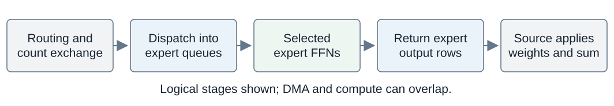
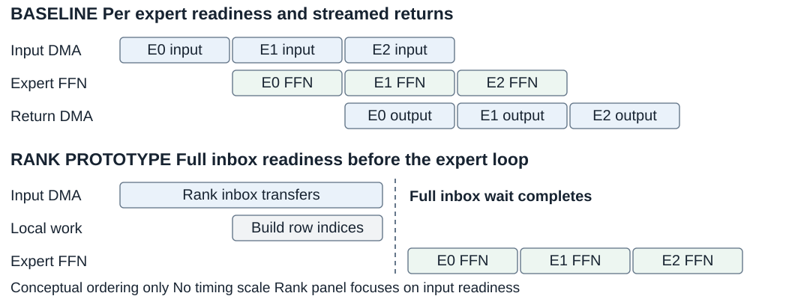
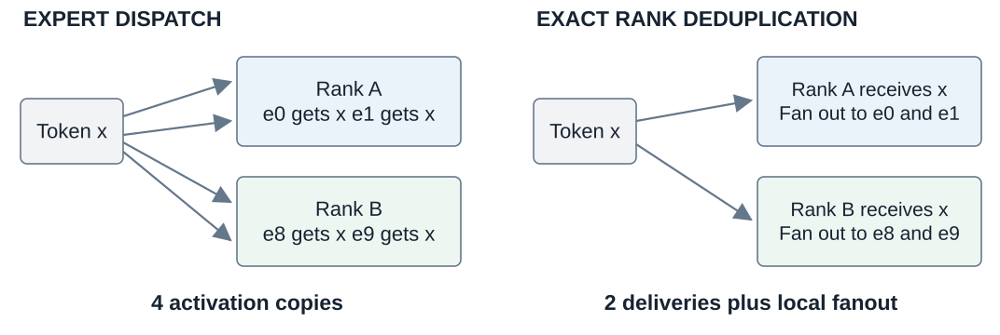
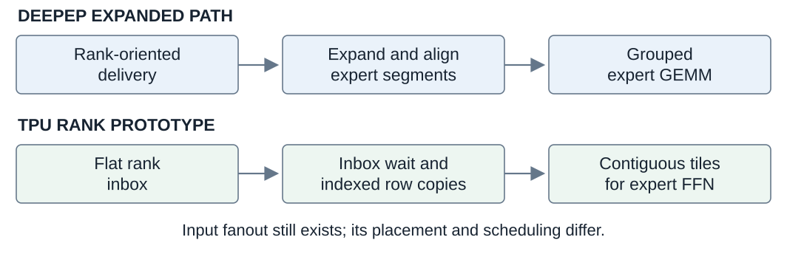
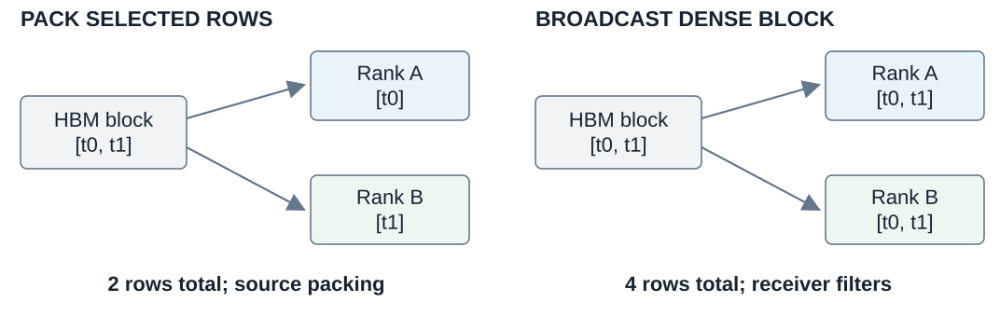
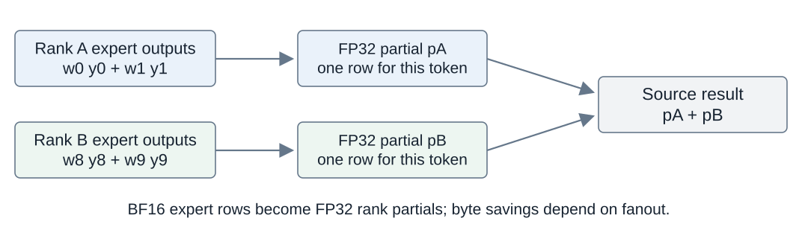

# MoE Communication Optimization Exploration

## TLDR

- **The existing path dispatches a token's activation once for each selected expert and returns expert outputs for a weighted sum.** Several selected experts on one rank therefore receive repeated copies.
- **Our idea:** send the activation once per destination rank and reuse it locally. We derived this idea from the repeated transfers in the TPU kernel.
- **Related work found during exploration:** [DeepEP](https://github.com/deepseek-ai/DeepEP/blob/b5a33eefda39485f438dc764695b71ba7b9249b6/README.md) uses a similar high-level idea on GPUs. We identified it as related work after proposing rank reuse.
- **Three directions:** exact rank deduplication, regular dense broadcast, and destination-side combine. A direct-row diagnostic tests the role of source packing.
- **Measured result:** packed dispatch was slower in the completed cases. Broadcast lowered kernel p50 by **4.77% at T=32** and **4.15% at T=64**, then lost its benefit at larger token counts.
- **Main finding:** the baseline pipelines communication with expert computation and streams completed outputs back. Reducing bytes may save little exposed time, while coarser waits and extra local work can reduce overlap. This is a plausible contributor to the results; its timing impact still needs profiling.

**Evidence boundary:** these are synthetic TPU kernel experiments from an experimental worktree. The highlighted broadcast runs used matched explicit tiles rather than production-resolved tiles. Serving validation remains pending; the GPU comparison is based on source inspection.

## Contents

- [Existing MoE communication flow](#existing-moe-communication-flow)
- [Why pipelining can outweigh byte savings](#why-pipelining-can-outweigh-byte-savings)
- [Motivation and the optimization directions](#motivation-and-the-optimization-directions)
- [GPU precedent and DeepEP](#gpu-precedent-and-deepep)
- [Direction 1 Rank deduplication](#direction-1-rank-deduplication)
- [Direction 2 Dense rank broadcast](#direction-2-dense-rank-broadcast)
- [Broadcast measurements and limits](#broadcast-measurements-and-limits)
- [Direction 3 Destination combine](#direction-3-destination-combine)
- [A controlled combine experiment](#a-controlled-combine-experiment)
- [Measurement and correctness protocol](#measurement-and-correctness-protocol)
- [Findings evidence and next experiments](#findings-evidence-and-next-experiments)

<!-- pagebreak -->

## Existing MoE communication flow

A router selects `K` experts and weights per token. Each expert-parallel rank owns a subset of experts. The logical flow is:

Figure 1. Routing and count exchange → dispatch → expert computation → return → weighted combine. DMA and compute can overlap.

### The five stages

1. **Route:** produce expert IDs and router weights before the fused kernel runs. Retain the token/route identity needed to combine returned outputs.
2. **Exchange counts:** collect per-expert token counts and derive expert sizes and source-prefix offsets. The preserved `all_reduce_metadata` scope gathers peer histogram rows and reduces them locally.
3. **Dispatch one activation row per token/expert route.** Remote DMA writes directly into the selected expert's final queue slot; local routes use local copies. Several experts on one rank can therefore receive repeated copies of the same activation.
4. **Compute:** wait for the current expert's receive completion, load contiguous input rows, and run its FFN. Later experts can still be receiving; later-block dispatch and completed-expert return can overlap other work.
5. **Return and combine:** return expert output rows, then apply router weights and sum on the source. Return DMA can group rows by expert and source block: **row counts and transfer-start counts differ**.

### What the baseline already does well

- **Direct placement:** DMA destination addresses perform the routing permutation into expert-major queues.
- **Fine readiness:** an expert can proceed when its own input is ready.
- **Pipelined communication and computation:** later expert inputs can arrive during current expert compute; completed expert outputs can return during later compute. Cross-block overlap depends on the configured pipeline and bank depth.
- **Safe reuse:** rotating banks and completion waits protect outstanding transfers.
- **Local traffic accounting:** local copies do not consume ICI link traffic.

Notation: `T` = global token rows in one MoE invocation; `H` = hidden width; `I` = expert intermediate width; `E` = expert count; `K` = selected experts per token; EP = expert-parallel ranks. `T` is not sequence length or a number of decode iterations.

<!-- pagebreak -->

## Why pipelining can outweigh byte savings

**The baseline is designed to overlap communication with useful computation.** Kernel latency depends on the work exposed on the critical path, so fewer transferred bytes need not translate into an equal reduction in elapsed time.

Figure 2. Illustrative schedule only, not a measured trace. Bars have no timing scale; actual overlap depends on transfer scheduling, expert load, tiles, and bank configuration.

### What the baseline can overlap

- **Input and compute:** asynchronous dispatch writes final expert queues. After the current expert's receive completes, its FFN can run while later expert inputs are still arriving.
- **Output and compute:** return DMA starts after each expert finishes, allowing earlier outputs to travel while later experts compute.
- **Across token blocks:** banked paths can leave returns outstanding while later blocks execute. Dispatch lookahead and the amount of outstanding work depend on the resolved overlap flags, bank depth, and block count.

### What our prototypes change

- **Rank dispatch and broadcast:** the scatter routine reconstructs expert membership and waits for the full rank inbox before the expert loop. A ready expert can therefore wait for unrelated rows. Indexed input preparation also adds local work.
- **Destination combine:** this prototype starts rank-partial return after the local expert loop, replacing streamed per-expert returns with a later return phase. Fewer return bytes can come with a longer exposed tail.

### What we can conclude

**Saving already-hidden transfer time may not shorten the kernel; lost overlap and added preparation can erase payload savings.** The code establishes these scheduling differences. Historical whole-kernel timings do not quantify their contribution or show that all baseline communication is hidden.

Compare traces for first-expert start, exposed receive waits, compute idle gaps, and the return tail using identical inputs and resolved configurations. Readiness and pipeline ablations must preserve traffic and compute where possible; report resource changes too.

Source: [scatter readiness, per-expert return, and block scheduling](../../../python/sgl_jax/srt/kernels/fused_moe/v2/kernel.py).

<!-- pagebreak -->

## Motivation and the optimization directions

### The opportunity

- A token's input vector is identical across its selected expert routes.
- **Several experts on one rank can reuse one delivered copy.** Each expert still applies its own weights and computes its own output.
- Expert IDs, Top-K slots, router weights, and token identity must remain aligned.
- Repeated delivery suggests an opportunity; it does not prove that communication dominates kernel time.

Figure 3. Top-K 4 across two ranks: four expert copies become two rank deliveries plus local fan-out. Exclude copies to the source rank from ICI estimates.

### Questions we tested

| Direction | Prototype | Question |
|---|---|---|
| Exact deduplication | `rank_dispatch` and `rank_direct` | Can fewer rows repay packing and receiver work? |
| Regular transfers | `rank_broadcast` | Can simpler block DMAs repay extra rows? |
| Return reduction | `rank_dispatch_combine` | Can local weighted sums reduce return cost? |

We built **CPU routing references, controlled routing patterns, payload/start-count models, and TPU comparisons**.

The receiver remains part of the optimization:

- Rank transport produces an inbox, which must become usable expert input.
- Reconstruction, local fan-out, indexed loads, and readiness can offset saved payload.
- Rank-direct removes ragged packing; broadcast also preserves block transfers. These are diagnostics of different tradeoffs.

Block tuning and VMEM search remain in the [broader report](REPORT.md). Metadata exchange is baseline context here; no independent metadata-collective speedup is claimed.

<!-- pagebreak -->

## GPU precedent and DeepEP

### How we connected the ideas

**We proposed rank reuse from the TPU baseline, then found similar GPU work during exploration.** DeepEP is related work sharing the high-level transport idea; our prototypes were not a port of its implementation.

Two details matter in DeepEP's source and integration:

- Its [EPHandle contract](https://github.com/deepseek-ai/DeepEP/blob/b5a33eefda39485f438dc764695b71ba7b9249b6/deep_ep/buffers/ep.py) counts a received token once per scale-up rank, even when several selected experts are there.
- Its [recommended integration](https://github.com/deepseek-ai/DeepEP/blob/b5a33eefda39485f438dc764695b71ba7b9249b6/README.md) uses `do_expand=True` and expert alignment for grouped GEMMs. **One transport copy can still become several local expert rows.**

Figure 4. DeepEP's recommended expanded layout and our TPU rank-inbox consumer have different local input preparation. The TPU row describes this prototype.

### What the comparison tells us

- **DeepEP:** rank-oriented delivery followed by aligned expert segments for compute.
- **Our rank prototype:** a flat inbox, inbox readiness, expert-membership reconstruction, and dynamic row copies into expert tiles.
- **Our baseline:** direct expert-queue placement and per-expert readiness.
- **Both platforms permit overlap.** DeepEP uses asynchronous event/stream integration; [Pallas remote DMA](https://docs.jax.dev/en/latest/pallas/tpu/distributed.html) can start a transfer and wait after other work.

**The useful question is how transport, local layout, and readiness work together.** This comparison establishes neither a GPU/TPU speed ratio nor a fundamental TPU limitation.

Sources inspected at DeepEP revision `b5a33eef` on 2026-10-18. **No GPU benchmark was run.**

<!-- pagebreak -->

## Direction 1 Rank deduplication

### Idea and payload model

- A Top-K 8 token selecting eight experts on one rank needs eight expert copies but only one rank delivery: **87.5% fewer logical activation rows**.
- If those experts span three ranks, exact deduplication sends three rows instead of eight.
- For BF16, expert dispatch is `2 * T * K * H` bytes; exact rank dispatch is `2 * T * R * H`, where `R` is mean distinct destination ranks per token.

**This is a payload model, not a latency measurement.** Exclude local routes for ICI estimates. Metadata, transfer startup, contention, and overlap also matter.

### Implementation

1. Scan routes and deduplicate destination ranks per token.
2. Pack selected rows into contiguous per-rank VMEM buckets.
3. Transfer each nonempty source-block/destination-rank bucket.
4. Reconstruct expert-to-inbox indices and load selected rows into contiguous expert tiles.

**Readiness changes too:** the prototype waits for the full rank inbox before entering its expert loop, replacing per-expert receive waits and potentially reducing [communication/compute overlap](#why-pipelining-can-outweigh-byte-savings).

### Results

Historical single-run means: **v6e-4, BF16, E=32, K=8, I=1024, one destination rank per token**. Reported numerical checks passed; runs came from an experimental working revision.

| Global T | H | Expert ms | Rank packed ms | Latency change |
|---:|---:|---:|---:|---:|
| 128 | 1024 | 0.071 | 0.106 | **49.3% higher** |
| 128 | 8192 | 0.328 | 0.337 | **2.7% higher** |
| 512 | 8192 | 1.258 | 1.334 | **6.0% higher** |

**Fewer logical rows did not make the complete path faster in these cases.**

### Rank direct diagnostic

- `rank_direct` stages the dense block and sends individual token/rank rows, removing ragged source packing.
- Historical notes report correct output and latency similar to packed dispatch at `T=128`; no standalone timing table was retained.
- Removing packing did not recover the baseline. This argues against packing as the sole cause, but does not isolate destination or overlap costs.

**Decision:** retain as research; keep `expert` as the default.

Source: [dispatch experiments and numerical notes](../../developer_guide/fused_moe_rank_dispatch_consultation_brief.md).

<!-- pagebreak -->

## Direction 2 Dense rank broadcast

### Why try sending extra rows

Packed dispatch saves rows but adds irregular work. Rank-direct removes packing but still starts a transfer per selected token/rank pair. **Broadcast tests regular block transfers without source packing**, accepting unused rows.

### How it works

- Start with the original dense `bt * H` source block.
- Send it once to each rank selected by any token in that block.
- Use routing metadata at the receiver to select useful rows and local experts.

Figure 5. Packing sends two useful rows; broadcast sends the two-row block to both ranks. The receiver filters unused rows.

The direct-HBM version:

- Uses the **original HBM block** as the DMA source.
- Removes an unused approximately **5 MiB source staging buffer** and its semaphore.
- Still needs destination reconstruction, indexed loads, and inbox readiness.

### Controlled transport counts

For `T=128`, `K=8`, EP=4, `bt=32`, each source block in the controlled one-rank-per-token pattern touches all four ranks:

| Dispatch mode | Rows | Transfer starts | Source treatment |
|---|---:|---:|---|
| Expert | 1024 | 1024 | Per expert route |
| Rank direct | 128 | 128 | Stage block then send rows |
| Rank packed | 128 | 16 | Pack selected rows |
| Rank broadcast | 512 | 16 | Send original dense block |

- Broadcast rows: `4 sources * 4 destinations * 32 rows = 512`.
- Its 16 starts comprise **12 remote and four local** transfers.
- Here it sends **4x the packed payload** with the same modeled start count.

**Algorithmic counts only:** these include local copies, exclude metadata/source staging, and are not hardware counters. Counts depend on routing.

Sources: [kernel](../../../python/sgl_jax/srt/kernels/fused_moe/v2/kernel.py) and [traffic models](../../../python/sgl_jax/tools/moe_rank_routing.py).

<!-- pagebreak -->

## Broadcast measurements and limits

**Setup:** v6e-4, random routing, BF16 activations/weights, `H=8192`, `I=1024`, `E=32`, `K=8`, EP=4. Each pair used identical explicit tiles; outer block sizes varied with `T`.

| Global T | Expert p50 ms | Broadcast p50 ms | Latency change | Evidence |
|---:|---:|---:|---:|---|
| **32** | 0.303173 | **0.288712** | **4.77% lower** | Three A/B pairs |
| **64** | 0.313143 | **0.300163** | **4.15% lower** | Three A/B pairs |
| 128 | 0.448801 | 0.445009 | 0.85% lower | Single sweep |
| 256 | 0.949149 | 0.953810 | 0.49% higher | Single sweep |
| 512 | 2.006105 | 2.037165 | 1.55% higher | Single sweep |

**The highlighted rows are experimental matched-tile results, not production-relative serving gains.**

### How to read the numbers

- `T=32/64`: median of three run p50s from alternating expert/broadcast pairs; **10 samples per repeat record**.
- `T=128/256/512`: one crossover sweep; **five samples per record**. Small differences do not establish statistical significance.
- Latency change: `100 * (broadcast / expert - 1)`.

### Qualification gaps

- **Dirty revision and synthetic inputs.** No checkpoint-backed serving A/B.
- **Non-production tiles:** `matches_production_block_config=false`. At `T=32`, the runs used `btc=bts=32`; production lookup resolved `btc=bts=8`.
- **No per-configuration correctness check:** records say `not_checked_per_config`. Separate checks at `T=128/512` do not certify every small-token case.

### Interpretation and decision

- Fewer starts and regular transfers may help at small `T`.
- Extra payload and receiver work may absorb that saving as `T` grows.
- Full-inbox readiness may reduce the baseline's communication/compute overlap, limiting the benefit of regular transfers.
- **Whole-kernel timing does not isolate those mechanisms.**

Keep broadcast experimental. Recheck exact production tiles, model routing, per-case correctness, and repeated timings before real-server TTFT, TPOT/ITL, throughput, and memory measurements.

Sources: [repeat expert](evidence/rank-broadcast-repeat1_random_t32_64_expert.jsonl), [repeat broadcast](evidence/rank-broadcast-repeat1_random_t32_64_rank_broadcast.jsonl), [crossover expert](evidence/rank-broadcast-crossover-smoke_random_t32_64_128_256_512_expert.jsonl), [crossover broadcast](evidence/rank-broadcast-crossover-smoke_random_t32_64_128_256_512_rank_broadcast.jsonl).

<!-- pagebreak -->

## Direction 3 Destination combine

### Idea and implementation

The baseline returns one BF16 output row per expert route and weights/sums on the source. **Combine at the destination could return one partial per token/rank pair.**

In `rank_dispatch_combine`:

1. Send router weights with dispatch metadata.
2. Weight local expert outputs and accumulate an **FP32 partial** for each source token.
3. Return rank partials; sum them on the source.

Figure 6. All experts still compute. Moving the sum changes accumulation order and return precision.

### Precision determines byte savings

- BF16 expert return: `2 * T * K * H` bytes.
- FP32 rank-partial return: `4 * T * R * H` bytes.
- **Savings require R < K/2.** At Top-K 8, return bytes decrease below four ranks/token, are neutral at four, and increase above four.
- One-rank routing saves **75% of logical return bytes**, versus **87.5% for BF16 dispatch deduplication**. For ICI, count remote routes/partials only.

### What the historical test establishes

- **Setup:** v6e-4, BF16, `T=128`, `H=1024`, `E=32`, `K=8`, `I=1024`, one-rank routing.
- **Complete prototype:** 0.108 ms versus 0.071 ms for `expert` (**52.1% higher latency**).
- **Numerical check passed:** reported max absolute error 0.0001 and relative error 0.003623.
- **Evidence strength:** historical single-run means, not repeated paired measurements.

**This comparison changes dispatch and combine together. It does not show that destination combine alone is slower.** It includes packed dispatch, extra weight metadata, FP32 accumulation/return, buffer changes, and synchronization effects.

Source: [combine design and numerical evidence](../../developer_guide/fused_moe_rank_dispatch_consultation_brief.md).

<!-- pagebreak -->

## A controlled combine experiment

### Start with the closest existing control

Compare **rank_dispatch versus rank_dispatch_combine** using the same activation-dispatch algorithm, operands, routes, tiles, and hardware.

- This estimates the **complete combine-protocol change conditional on packed dispatch**.
- It includes necessary router-weight metadata, FP32 partials, accumulation, return, and changed overlap.
- It does not isolate scalar additions or raw network savings alone.

The old 0.106 ms and 0.108 ms points differ by about 2 microseconds. **Single-run, rounded, unpaired timings cannot establish a reliable incremental effect.** Rerun this as a controlled paired experiment.

### Isolate the return and combine path

Build a **return/combine-only microbenchmark** from identical precomputed expert outputs, routing IDs, and router weights already resident on the expert ranks.

- Compare expert-row return plus source weighting/sum against destination weighting/sum plus rank-partial return and final source sum.
- Include each method's required packing, accumulation, transfers, and completion waits. Exclude only common input generation; preserve realistic layouts and precision.
- This removes activation dispatch and FFN compute from timing. **It diagnoses the return protocol but cannot predict overlap in the fused kernel.**

### Then use a two by two matrix

| Cell | Dispatch | Combine location | Status |
|---|---|---|---|
| A | Expert-major | Source | Existing `expert` |
| B | Rank-packed | Source | Existing `rank_dispatch` |
| C | Expert-major | Destination | **Proposed and not implemented** |
| D | Rank-packed | Destination | Existing `rank_dispatch_combine` |

**Cell C must preserve the baseline activation layout and expert readiness.** The current mode flags do not provide this independent combination; adding it requires implementation and validation.

### Questions the matrix answers

- **D versus B:** combine-protocol effect with rank-packed dispatch.
- **C versus A:** combine-protocol effect with expert-major dispatch.
- **B versus A:** dispatch effect with source combine.
- **Interaction:** `(L_D - L_B) - (L_C - L_A)`, where `L` is whole-kernel latency. A nonzero interaction means the combine effect depends on dispatch. Negative latency differences indicate improvement.

Keep each pair's configuration fixed. Tune each complete method independently only in a separate practical-performance study; do not mix tuning gains into this attribution experiment.

**Proposed experiment only:** no new mode or accelerator run was added while preparing this report.

<!-- pagebreak -->

## Measurement and correctness protocol

### Control the comparison

- Use identical activation tensors, expert weights, routing IDs/weights, seeds, shapes, and EP topology within each comparison.
- Fix tiles, quantization, shared-expert settings, overlap flags, and software/device versions. Save the clean commit and resolved configuration.
- Count required metadata and buffer work as part of the complete protocol. Record compiler/resource changes rather than assuming the executable differs only in a small arithmetic block.

### Validate every measured configuration

- Check against an **FP32 reference** using predetermined dtype-appropriate absolute/relative tolerances. Changed summation order need not be bit-identical.
- Cover unequal router weights, empty experts, zero-transfer ranks, padded blocks, skew, high fan-out, and repeated buffer reuse.
- Record numerical failures, compilation failures, and memory failures alongside successful cases.

### Use paired repeated measurements

1. Compile and warm each variant; exclude compilation, reference computation, and profiling from final timings.
2. Alternate or randomize A/B order on the same hardware. Measure completed device work, not asynchronous host dispatch alone.
3. Start with **10 run pairs as a variance pilot**; choose final repetitions for a predeclared minimum useful effect.
4. Report run-level p50/p95 and paired latency ratios with **95% uncertainty intervals**. Treat a run pair as the resampling unit; samples within a run are correlated.
5. Predeclare the primary metric and practical gain threshold. Report the full matrix, not only winning shapes.

### Separate effectiveness from mechanism

- Begin with the historical `T=128`, `H=1024` case, then `H=8192`; expand to `T=32/64/128/256/512`, controlled fan-out, random routes, and skew.
- Above-four-rank fan-out requires EP greater than four. If testing one-rank Top-K routing, ensure each rank owns at least `K` distinct experts.
- In separate diagnostic runs, inspect metadata, expert-input preparation, accumulation, return DMA, source combine, and exposed waits. **Overlapping stage times cannot simply be added or subtracted to explain fused latency.**
- Use measured traffic counters when available; otherwise label byte/start counts as models. Report memory footprint and synchronization costs too.

Only candidates that pass correctness and repeated kernel comparisons should proceed to checkpoint-backed serving A/B tests.

<!-- pagebreak -->

## Findings evidence and next experiments

### Findings and next actions

- **Packed dispatch:** fewer logical rows, but higher completed kernel latency. Coarser inbox readiness and local preparation may offset savings from transfers the baseline can overlap; confirm with traces and controlled ablations.
- **Broadcast:** a small-token benefit in matched-tile experiments. Recheck production-resolved tiles and actual model routing.
- **Combine:** the complete packed/combine prototype was slower than `expert`; combine's independent effect remains open. Run the paired control and proposed matrix above.
- **Serving:** no MoE communication change here has checkpoint-backed qualification. Keep `expert` as the default.

### Code and evidence

- **Implementation:** [Pallas kernel](../../../python/sgl_jax/srt/kernels/fused_moe/v2/kernel.py), [routing reference](../../../python/sgl_jax/tools/moe_rank_routing.py), [routing tests](../../../python/sgl_jax/test/kernels/fused_moe_rank_routing_test.py).
- **Experiment tools:** [benchmark](../../../python/sgl_jax/srt/kernels/fused_moe/v2/bench_v2.py) and [TPU runner](../../../scripts/run_fused_moe_rank_a2a_tpu.sh).
- **Broadcast raw records:** six small-token repeat files and two crossover files in [evidence](evidence/), preserved by the [SHA256 manifest](evidence/manifest.json).
- **Remaining repeat pairs:** [pair two expert](evidence/rank-broadcast-repeat2_random_t32_64_expert.jsonl), [pair two broadcast](evidence/rank-broadcast-repeat2_random_t32_64_rank_broadcast.jsonl), [pair three expert](evidence/rank-broadcast-repeat3_random_t32_64_expert.jsonl), [pair three broadcast](evidence/rank-broadcast-repeat3_random_t32_64_rank_broadcast.jsonl).
- **Historical notes:** [consultation brief](../../developer_guide/fused_moe_rank_dispatch_consultation_brief.md) and [deep dive](../../developer_guide/fused_moe_v2_optimization_deep_dive.md). Early packed/combine timings and the qualitative rank-direct diagnostic lack a standalone raw packet in this report's evidence directory.

### Recompute the broadcast table

1. Group repeat records by `a2a_mode` and `tokens`.
2. For `T=32/64`, take the median of `latency_p50_ms` across the three repeats.
3. For `T=128/256/512`, use the crossover record and retain its weaker evidence label.
4. Compute change as `100 * (broadcast / expert - 1)`.

Recomputing these records does not rerun a TPU experiment or make the historical source revision clean.
